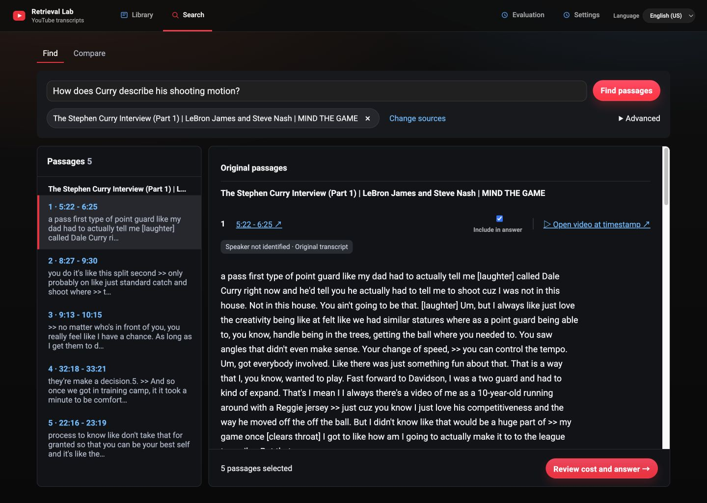
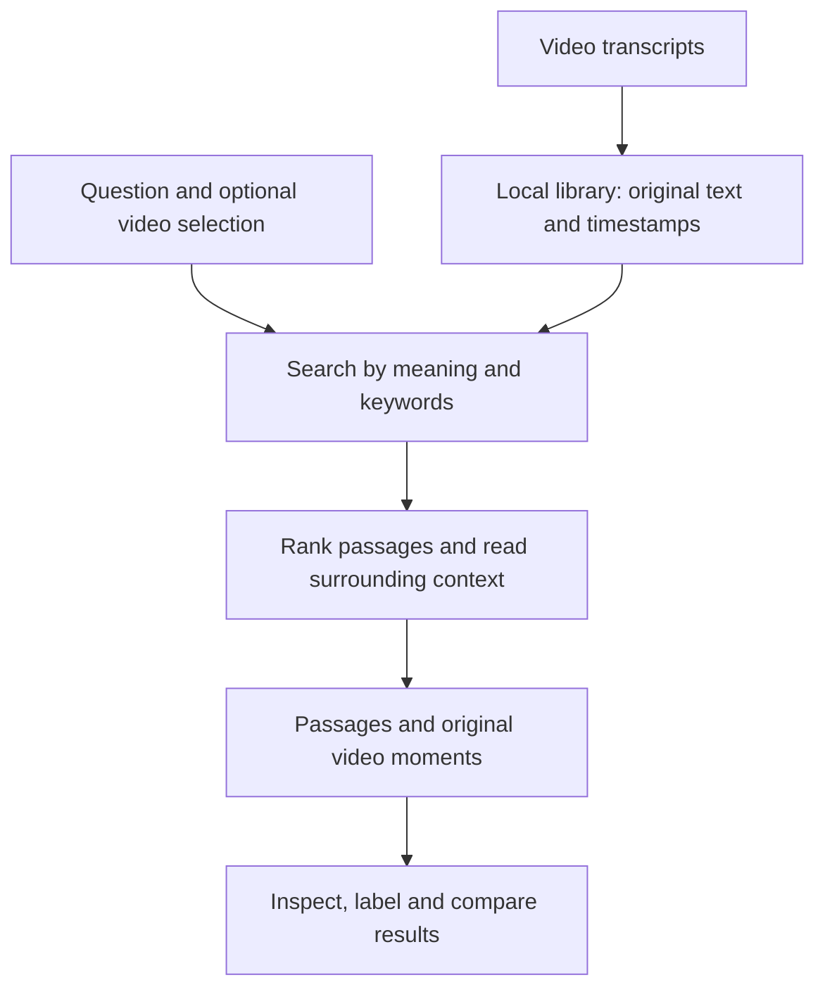

# Media Retrieval Lab: Video & Podcast Search, Q&A and Summaries

[](https://github.com/mikeh-studio/media-retrieval-lab/actions/workflows/ci.yml)
[](LICENSE)

**Find the original moment behind a question.** Search English and Japanese
video and podcast transcripts locally, compare retrieval strategies, and inspect the
original timestamped evidence before trusting an answer.



The public workbench combines meaning-based search (E5 embeddings and FAISS)
with Japanese-aware keyword search (BM25). An optional deterministic agent reads
surrounding context or tries another search path when evidence is weak.

## Try it locally

Use Python 3.11, as in CI. No private repository or provider key is needed for
search and the offline evaluation fixture.

```bash
python3.11 -m venv .venv
source .venv/bin/activate
python -m pip install --upgrade pip setuptools -c requirements-security.txt
python -m pip install -r requirements.txt
[ -f .env.local ] || cp .env.example .env.local
python local_preview/local_api.py
```

Open [the local app](http://127.0.0.1:8000/index.html), index a video with an
available transcript, and open **Search**. The first start downloads the E5
model (about 2.2 GB). [Offline mode and cached local models](docs/configuration.md#embeddings)
are documented separately; hashing fallback is not equivalent to E5 retrieval.
Indexing a new YouTube transcript requires network access.

Optional answers and study materials use the provider selected in the UI. Add
`OPENAI_API_KEY`, `ANTHROPIC_API_KEY` or `SAKANA_API_KEY` to `.env.local` for those
features. Node.js is only needed to rebuild the frontend, not to run the app.

## What you can do

| Workflow | Purpose |
| --- | --- |
| **Library → Search** | Index transcripts and search selected videos or your whole library. |
| **Inspect evidence** | Read passages and context, follow timestamps, and select sources for an optional answer. |
| **Search → Evaluation** | Label results in Compare; open **+ Query sets** in Evaluation for datasets; import saved reports for review. |
| **Answer** | Review selected sources and the token budget, then generate an optional cited answer. It answers the parts the evidence covers, says which parts it doesn't, and cites every factual sentence. |
| **Key areas** | Split an episode into the show's own sections, each with key points that cite transcript lines and link to the moment. |
| **Collection summaries** | Compare 2–12 videos by theme, with each source's stance cited to its own passages. |

The optional **Catalog** reads metadata from a separate private service. It is
not required for the public workbench; catalog discovery does not automatically
index videos. [Catalog boundary and setup](docs/catalog-browser.md).
[Study, Chunking, Data quality and local-video OCR](local_preview/README.md)
remain available under **Settings**.

## How retrieval works



For a question across the whole library, Ask first shortlists the videos most
likely to hold the answer, scoring each by its profile and its best-matching
passages, then searches passages inside that shortlist.

Original transcripts remain the source of truth. Derived chunks, indexes and
video-routing profiles can be rebuilt. Semantic, lexical and hybrid search are
available, with optional cross-encoder reranking. The browser's agentic policy
is provider-free; it is separate from an LLM using external tools.

See [architecture](docs/architecture.md) and [retrieval](docs/retrieval.md) for
routing, fusion, context expansion, reranking and feedback behavior.

## Inspect the evidence

Original-language text and source moments let you check what was actually
retrieved. A translation is an explanation, not an original quotation. A title
or appearance credit does not establish who spoke, and an authentic citation
can still be irrelevant to the question.

The screenshot at the top uses the development question **“How does Curry describe
his shooting motion?”**, scoped to **The Stephen Curry Interview (Part 1)** with
LeBron James and Steve Nash. It shows full original passages from the real local
backend, not a generated answer. Rankings can include irrelevant passages and
miss required context; this is an unjudged workflow example, not measured accuracy.

## Evaluation

Results come from labeled evidence on local transcripts that stay out of the
repository.

| Area | Result |
| --- | --- |
| Retrieval ranking | On 42 English and Japanese question forms, nDCG@10 is 0.626 for dense and 0.590 for hybrid search. Translating cross-language questions adds +0.33 for BM25. Labels are model-judged. [Development study](docs/evaluation-development-study.md) |
| Episode key areas | On 8 long-form episodes with owner-reviewed gold: faithfulness 0.986, weighted key-point recall 0.966, section boundary F1@30s 0.553. The owner agreed with 19 of 20 audited judge decisions. |
| Cross-source Ask | On 12 questions spanning 2–3 videos, answer source coverage rose from 0.417 to 0.71, mostly from answering covered parts instead of declining. |
| Answer quality | Scoring method added; judged scores wait for the owner audit. |

[Results, regression floors and methods](docs/evaluation.md). Run the offline
fixture without network access, model downloads or provider keys:

```bash
python -m evals.runner \
  --dataset evals/datasets/jp_core_v1.example.jsonl \
  --config evals/configs/baseline.yaml \
  --out evals/reports/latest
```

## Experimental MCP companion

A separate, experimental companion explores giving AI assistants read-only
access to transcript evidence through the Model Context Protocol (MCP). It is not
part of this quick start. [Architecture and boundaries](docs/architecture.md#experimental-mcp-companion).

## Limits

- Public setup works independently of the optional private catalog and MCP service.
- Interactive labels are single-reviewer; benchmark fixture results are not a statistically representative corpus evaluation.
- Query sets, their labels and retrieval runs use browser storage; clearing it removes them. Imported evaluation reports are local files under `data/runtime/evaluation_reports/`.
- Retrieval depends on transcript availability. Playlist page parsing can change.
- The app is loopback-only and has no account system. [Security and privacy](SECURITY.md) · [Browser request boundary](BROWSER_SECURITY.md).
- OCR accepts only local video files you own or have permission to process; the project does not download YouTube video files.

## Development

```bash
python -m pip install pytest
python -m pytest tests/ multilingual/tests/ -q
```

[Configuration and frontend checks](docs/configuration.md),
[local API/operator guide](local_preview/README.md),
[architecture](docs/architecture.md) and [evaluation](docs/evaluation.md) cover
the detailed workflows. Historical changes are recorded in pull requests.

## License

Public code and documentation use the [MIT License](LICENSE). The separate
private companion has its own license. Video content, transcripts and metadata
remain subject to their owners' terms.
