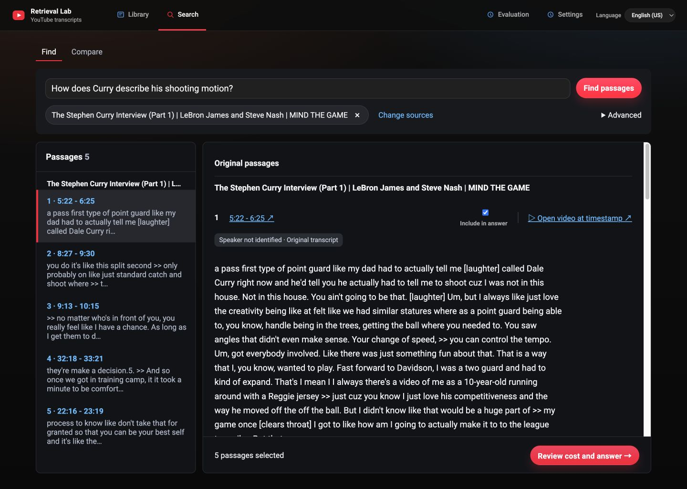
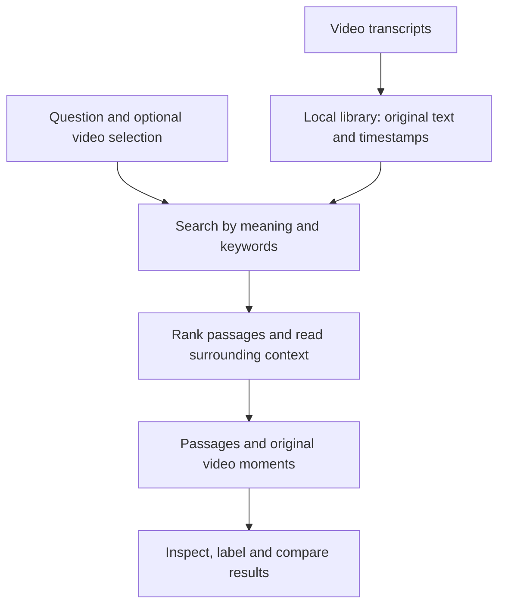
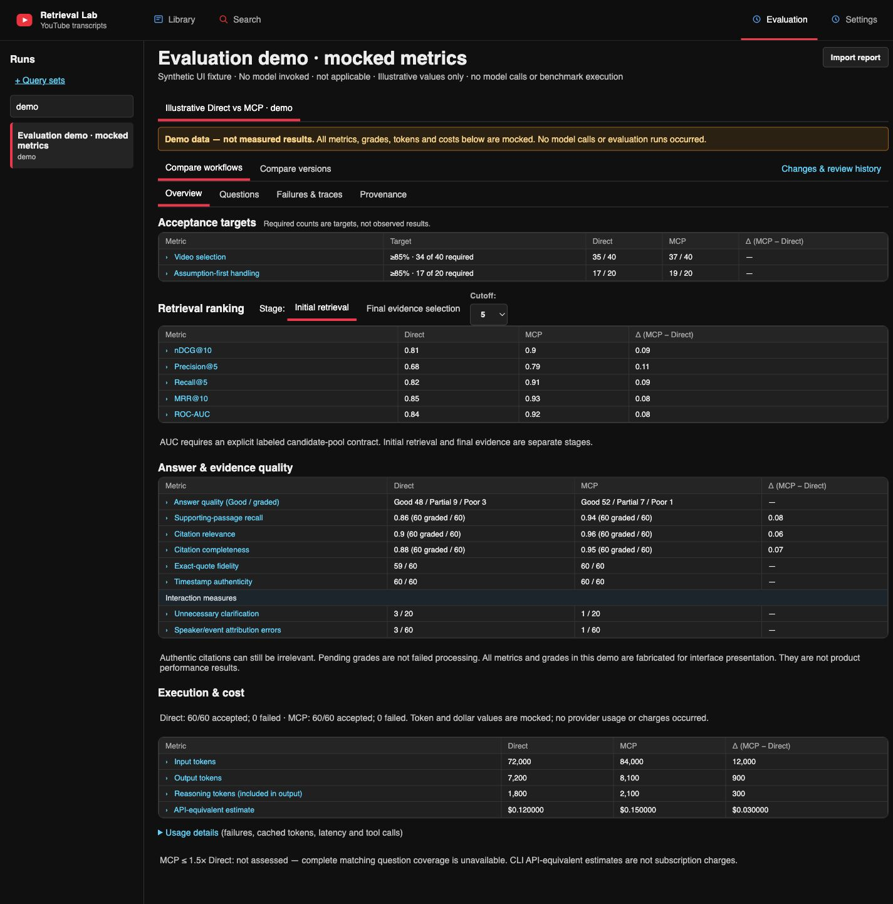
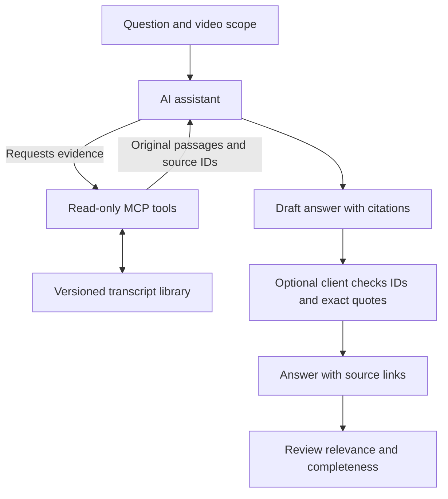

# YouTube Transcript Retrieval Lab

[](https://github.com/mikeh-studio/youtube-transcript-retrieval-lab/actions/workflows/ci.yml)
[](LICENSE)

**Find the original moment behind a question.** Search English and Japanese
YouTube transcripts locally, compare retrieval strategies, and inspect the
original timestamped evidence before trusting an answer.



The public workbench combines meaning-based search (E5 embeddings and FAISS)
with Japanese-aware keyword search (BM25). An optional deterministic agent reads
surrounding context or tries another search path when evidence is weak.

## Try it locally

Use Python 3.11, as in CI. No private repository or provider key is needed for
search and the offline evaluation fixture.

```bash
python3.11 -m venv .venv
source .venv/bin/activate
python -m pip install -r requirements.txt
[ -f .env.local ] || cp .env.example .env.local
python local_preview/local_api.py
```

Open [the local app](http://127.0.0.1:8000/index.html), index a video with an
available transcript, and open **Search**. The first start downloads the E5
model (about 2.2 GB). [Offline mode and cached local models](docs/configuration.md#embeddings)
are documented separately; hashing fallback is not equivalent to E5 retrieval.
Indexing a new YouTube transcript requires network access.

Optional answers and study materials use the provider selected in the UI. Add
`OPENAI_API_KEY`, `ANTHROPIC_API_KEY` or `SAKANA_API_KEY` to `.env.local` for those
features. Node.js is only needed to rebuild the frontend, not to run the app.

## What you can do

| Workflow                | Purpose                                                                                                                                                         |
| ----------------------- | --------------------------------------------------------------------------------------------------------------------------------------------------------------- |
| **Library → Search**    | Index transcripts, scope a question to selected videos or the whole library, and compare two retrieval setups side by side.                                     |
| **Inspect evidence**    | Read full original passages and nearby context, follow timestamp links, and explicitly select passages for an optional answer.                                  |
| **Search → Evaluation** | Use Compare mode for relevance labels and query sets; import saved CLI/API or offline benchmark reports to inspect rankings, grades, failures, usage and costs. |
| **Answer**              | Review the selected evidence and token budget, then optionally generate a cited answer. Sources do not silently change; citation relevance still needs review.  |

The optional **Catalog** reads metadata from a separate private service. It is
not required for the public workbench; catalog discovery does not automatically
index videos. [Catalog boundary and setup](docs/catalog-browser.md).
[Study, Chunking, Data quality and local-video OCR](local_preview/README.md)
remain available under Tools.

## How retrieval works



Original transcripts remain the source of truth. Derived chunks, indexes and
video-routing profiles can be rebuilt. Semantic, lexical and hybrid search are
available, with optional cross-encoder reranking. The browser's agentic policy
is provider-free; it is separate from an LLM using external tools.

See [architecture](docs/architecture.md) and [retrieval](docs/retrieval.md) for
routing, fusion, context expansion, reranking and feedback behavior.

## Inspect the evidence

Original-language text and source moments let you check what was actually
retrieved. A translation is an explanation, not an original quotation. A title
or appearance credit does not establish who spoke, and an authentic citation
can still be irrelevant to the question.

The reader screenshot uses the development question **“How does Curry describe
his shooting motion?”**, scoped to **The Stephen Curry Interview (Part 1)** with
LeBron James and Steve Nash. It shows full original passages from the real local
backend, not a generated answer. Rankings can include irrelevant passages and
miss required context; this is an unjudged workflow example, not measured accuracy.

## Evaluation status

| Area                          | Current evidence                                                                                                                                                                 |
| ----------------------------- | -------------------------------------------------------------------------------------------------------------------------------------------------------------------------------- |
| Regression fixture            | A small, checked-in Japanese fixture exercises retrieval and scoring with hand-authored dense scores. [Commands, results and limitations](docs/evaluation.md#offline-benchmark). |
| Retrieval defaults            | Baseline RRF remains the default hybrid profile. Experimental profiles and reranking are opt-in.                                                                                 |
| Independent answer evaluation | Answer quality and cost evaluation remains incomplete. The separate 85% source-selection and underspecification-handling targets are not verified results.                       |



The saved-report view keeps ungraded quality metrics pending; it does not claim
the acceptance targets passed. See the [UI review findings](docs/design/evidence-workspace-review.md)
for the independent review and validation limits.

Run the offline fixture without network access, model downloads or provider keys:

```bash
python -m evals.runner \
  --dataset evals/datasets/jp_core_v1.example.jsonl \
  --config evals/configs/baseline.yaml \
  --out evals/reports/latest
```

Fixture scores do not establish real-world retrieval accuracy. Mechanical
citation checks do not establish claim support or answer completeness.
[Evaluation methods](docs/evaluation.md) explain labels, saved runs and limits.

## Experimental MCP companion

A separate **private, experimental companion** explores exposing versioned
transcript evidence to AI assistants through the Model Context Protocol (MCP).
It is not included in this public quick start and is not the backend of the
browser workbench's normal search.



The assistant writes the draft; MCP provides the tool interface. The optional
client validates issued identifiers and exact quoted text and renders source
links. Ordinary MCP clients do not automatically inherit those checks. People
still assess relevance, completeness and speaker/event attribution.

The companion uses a separate PostgreSQL/pgvector runtime. Moving a library
between the two systems requires an explicit
[versioned export/import contract](docs/contracts/youtube-library-export-v1.md);
there is no automatic synchronization. [Companion architecture and boundaries](docs/architecture.md#experimental-mcp-companion).

## Recent improvements and limits

The workspace now separates Find from Compare, expands original transcript
evidence, and binds optional answers to selected canonical passages. Evaluation
reviews explicitly imported reports; Query sets retains the dataset workbench.
Settings keeps safe browser defaults separate from server credentials. Library
deletions persist across restarts, and cached model revisions guard index compatibility.
[Model configuration](docs/configuration.md#embeddings) explains the settings.

- Public setup works independently of the optional private catalog and MCP service.
- Interactive labels are single-reviewer; benchmark fixture results are not a statistically representative corpus evaluation.
- Evaluate query sets and runs use browser storage; clearing it removes them.
- Retrieval depends on transcript availability. Playlist page parsing can change.
- The app is loopback-only and has no account system. [Browser request boundary](BROWSER_SECURITY.md).
- OCR accepts only local video files you own or have permission to process; the project does not download YouTube video files.

## Development

```bash
python -m pip install pytest
python -m pytest tests/ multilingual/tests/ -q
```

[Configuration and frontend checks](docs/configuration.md),
[local API/operator guide](local_preview/README.md),
[architecture](docs/architecture.md) and [evaluation](docs/evaluation.md) cover
the detailed workflows. Historical changes are recorded in pull requests.

## License

Public code and documentation use the [MIT License](LICENSE). The separate
private companion has its own license. Video content, transcripts and metadata
remain subject to their owners' terms.
