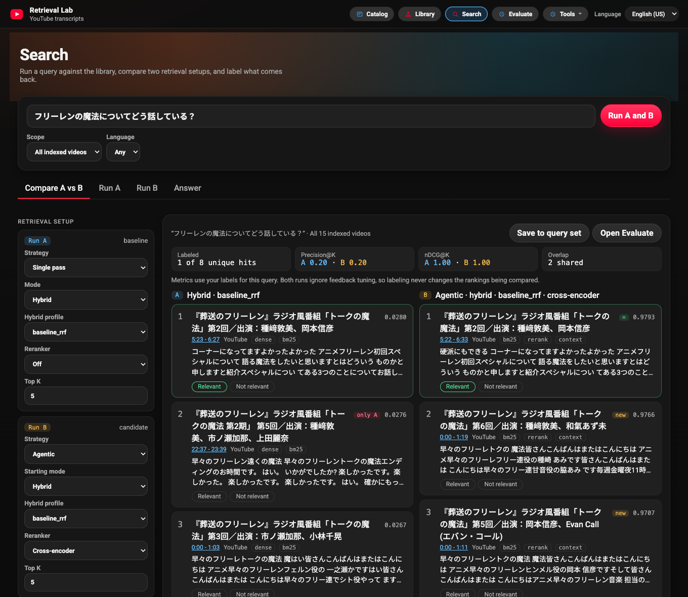

# YouTube Transcript Retrieval Lab

[](https://github.com/mikeh-studio/youtube-transcript-retrieval-lab/actions/workflows/ci.yml)
[](LICENSE)

A local retrieval lab for English and Japanese YouTube transcripts. Discover
videos into a catalog, index the ones you review, run retrieval strategies side
by side, and measure the results with labels and ranking metrics. The raw
timestamped transcript stays the source of truth for every result and answer.



## The lab

The app follows the lab workflow: **Catalog → Library → Search → Evaluate**.

| Page | What it does |
| --- | --- |
| **Catalog** | Browses discovered videos with metadata, catalog topics, review status, and provenance. Read-only and optional; it reads from a separate private catalog service. Cataloged videos are not searchable until they are indexed. |
| **Library** | Indexes YouTube videos and playlists, and lists indexed videos with chunk counts, chunking status, and catalog review status. |
| **Search** | Compares two retrieval setups side by side on one query (for example single-pass hybrid against agentic with reranking), with rank changes, relevance labels, per-query Precision@K and nDCG@K, and the trace of how each run found its results. Scope it to all videos, chosen videos, or a catalog filter. An Answer tab generates a cited answer or abstains. |
| **Evaluate** | Builds query sets, labels results, scores runs with Precision@K, Recall@K, MRR, and nDCG@K, compares runs, and drafts datasets with Codex CLI for human review. |
| **Tools** | Chunking (compare chunking strategies), Data quality (evidence curation reports), Search feedback (relevance feedback from Search), Local video (OCR for files you own), and Study. |

**Study** is a secondary tool: flashcards, topic maps, and five-theme summaries
built from an indexed video. Answers and study material can use OpenAI,
Anthropic, or Sakana AI; search, evaluation, and the offline benchmark need no
provider key.

## Engineering and evaluation

```text
Catalog (optional private service, metadata only)
  -> reviewed videos are indexed into the Library
YouTube transcript + metadata
  -> canonical timestamped segments (kept as evidence)
  -> chunks -> E5 + FAISS (semantic) and BM25 (keyword, Japanese-aware)
  -> optional video routing -> hybrid or agentic retrieval -> optional reranking
  -> ranked evidence, labels and metrics, or a grounded answer with citations
```

- **Catalog boundary:** the public app reads a validated, read-only projection
  of catalog records through a loopback proxy. Discovery, review, and storage
  live in the private service; cataloging never triggers ingestion.
- **Retrieval:** dense, lexical, and hybrid (reciprocal-rank fusion) search,
  with an opt-in multilingual cross-encoder reranker.
- **Agentic search:** a deterministic, provider-free policy chooses semantic or
  keyword search, switches tools when evidence is weak, and reads nearby
  transcript context. Every decision is returned as an inspectable trace.
- **Video routing:** a multi-vector router ranks videos by identity, overview,
  and section vectors before chunk retrieval.
- **Grounding:** answers must cite retrieved chunks; an evidence-sufficiency
  gate, which also handles cross-lingual matches, decides when to abstain.
- **Evaluation:** an offline benchmark compares retrieval strategies, and the
  Evaluate page supports human labels and run comparisons. The checked-in
  benchmark is an eight-query regression fixture with hand-authored dense scores;
  it tests the harness and does not establish real-world retrieval quality.

Read the [architecture](docs/architecture.md), [retrieval guide](docs/retrieval.md),
[evaluation guide](docs/evaluation.md), [catalog browser](docs/catalog-browser.md), and
[configuration reference](docs/configuration.md).

## How the project evolved

1. **Retrieval workbench:** transcript ingestion, summaries, and chunk
   comparison grew into an evaluation workspace with labels, ranking metrics,
   and an offline benchmark. See the [Chunking Lab](https://github.com/mikeh-studio/youtube-transcript-retrieval-lab/pull/6)
   and [offline benchmark](https://github.com/mikeh-studio/youtube-transcript-retrieval-lab/pull/20).
2. **Grounded answers:** Q&A moved from free-form answers to citations,
   confidence levels, and abstention, then gained a cross-lingual evidence gate.
   See [citation-backed answers](https://github.com/mikeh-studio/youtube-transcript-retrieval-lab/pull/10)
   and [cross-lingual grounding](https://github.com/mikeh-studio/youtube-transcript-retrieval-lab/pull/36).
3. **Agentic retrieval:** an LLM retry loop became a deterministic tool policy
   that is compared against semantic search in the same benchmark. See the
   [agentic loop](https://github.com/mikeh-studio/youtube-transcript-retrieval-lab/pull/26),
   [deterministic rewriting](https://github.com/mikeh-studio/youtube-transcript-retrieval-lab/pull/30),
   and [semantic vs. agentic comparison](https://github.com/mikeh-studio/youtube-transcript-retrieval-lab/pull/38).
4. **Library-scale search:** questions can be scoped to selected videos or routed
   across the whole library. See [video scope](https://github.com/mikeh-studio/youtube-transcript-retrieval-lab/pull/31)
   and [video-first routing](https://github.com/mikeh-studio/youtube-transcript-retrieval-lab/pull/35).
5. **Study and evaluation tooling:** the Study tool, human-reviewed evaluation
   datasets drafted with Codex CLI, local request protection, and a versioned
   library export. See [Study Studio](https://github.com/mikeh-studio/youtube-transcript-retrieval-lab/pull/22),
   [dataset generator](https://github.com/mikeh-studio/youtube-transcript-retrieval-lab/pull/37),
   [request boundary](https://github.com/mikeh-studio/youtube-transcript-retrieval-lab/pull/41),
   and [library export](https://github.com/mikeh-studio/youtube-transcript-retrieval-lab/pull/42).
6. **Catalog-first lab:** a read-only catalog of discovered videos, a
   navigation built around the lab workflow, a Library of indexed videos, and
   Search rebuilt as an A/B workbench. See the [catalog browser](https://github.com/mikeh-studio/youtube-transcript-retrieval-lab/pull/43),
   [lab navigation](https://github.com/mikeh-studio/youtube-transcript-retrieval-lab/pull/44), and the [Search workbench design](docs/design/README.md).

### Next

Move Evaluate, Chunking, and Data quality into the same app shell; keep Search
A/B runs in Evaluate's run history; and fold the Search feedback page into
Evaluate.

Release notes live in [`CHANGELOG.md`](CHANGELOG.md); planned work lives in [`TODOS.md`](TODOS.md).

## Run locally

Use Python 3.11 (the CI version). From the repository root:

```bash
python3.11 -m venv .venv
source .venv/bin/activate
python -m pip install -r requirements.txt
[ -f .env.local ] || cp .env.example .env.local
# Optional: add OPENAI_API_KEY, ANTHROPIC_API_KEY, or SAKANA_API_KEY for answers.
python local_preview/local_api.py
```

Open the [Library](http://127.0.0.1:8000/index.html), index a video with an
available transcript, then use Search and Evaluate. To browse the catalog, set
`CONTENT_LIBRARY_CATALOG_URL`; see the [catalog browser](docs/catalog-browser.md). The first start downloads
the `intfloat/multilingual-e5-large` embedding model (about 2.2 GB). To start
without it, see [offline mode](docs/configuration.md#offline-mode).

Run the offline benchmark without network access or provider keys:

```bash
python -m evals.runner \
  --dataset evals/datasets/jp_core_v1.example.jsonl \
  --config evals/configs/baseline.yaml \
  --out evals/reports/latest
```

For the operator workflows (ingestion checks, assisted labeling, local-video OCR,
and API examples), see the [local app guide](local_preview/README.md).

## Repository map

| Path | Contents |
| --- | --- |
| `local_preview/` | The local app: HTTP API, catalog read client, retrieval tools, agentic search, grounded answers, and UI (`web/` pages and shared `lab-nav.js`, `react_shell/` source) |
| `multilingual/` | Core engine: transcript processing, chunking, embeddings, FAISS/BM25 retrieval, reranking, and video routing |
| `evals/` | Offline retrieval benchmark and the video-routing evaluator |
| `pipelines/` | Evidence curation, local-video OCR, and library export scripts |
| `retrieval/` | OCR and multimodal (transcript + OCR) search helpers |
| `docs/` | Architecture, guides, data contracts, design mocks, and screenshots |
| `browser_boundary.py` | Same-origin request boundary for the local server |
| `tests/`, `multilingual/tests/`, `e2e/` | Python regression tests and Playwright browser checks |

## Known limitations

- Evaluation is single-reviewer; inter-rater agreement is not implemented.
- Evaluate query sets, labels, and runs are stored in browser `localStorage`
  and disappear when browser storage is cleared.
- The checked-in benchmark is a small deterministic fixture, not a statistically
  stable corpus. Baseline RRF remains the default hybrid profile.
- Retrieval depends on YouTube transcript availability. Playlist ingestion
  parses the playlist page and can break if that page changes.
- The app and the catalog proxy are loopback-only with no account system; see the
  [browser request boundary](BROWSER_SECURITY.md).
- Local-video OCR only accepts video files you own or have permission to
  process. The project does not download YouTube video files.

## Development and tests

```bash
python -m pip install pytest
python -m pytest tests/ multilingual/tests/ -q
```

Frontend builds, browser checks, and the full test matrix are covered in
[development](docs/configuration.md#development-and-tests). Tests and browser
fixtures do not establish live ingestion or answer quality.

## License

Code and documentation use the [MIT License](LICENSE). YouTube content,
transcripts, and metadata remain subject to their owners' terms.
