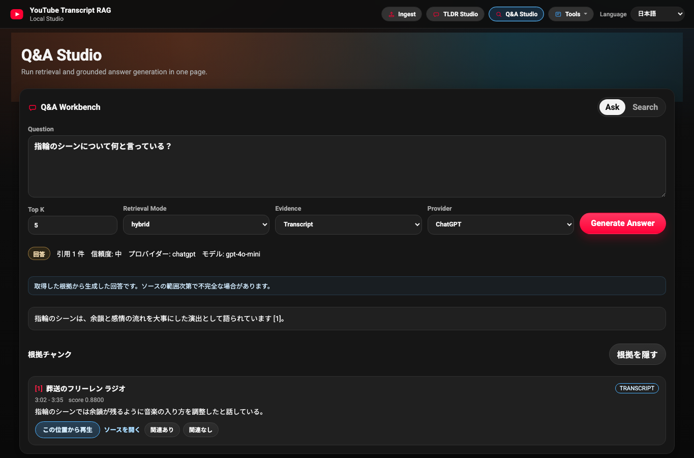

# YouTube Transcript Retrieval Lab

[](https://github.com/mikeh-studio/youtube-transcript-retrieval-lab/actions/workflows/ci.yml)
[](LICENSE)

Study long English and Japanese YouTube videos, ask questions about them, and
check every answer against the timestamped transcript. The lab runs locally,
keeps the raw transcript as the source of truth, and makes retrieval quality
something you can label, measure, and compare.



## Explore

| Workspace | What it does |
| --- | --- |
| **Q&A Studio** | Answers questions from retrieved transcript evidence, with numbered citations, a confidence level, and an explicit "insufficient evidence" state. Searching all videos shortlists the relevant ones first. |
| **TLDR Studio** | Summarizes a full transcript into five ranked themes with timestamp links. |
| **Study Studio** | Builds speaker-aware flashcards, topic maps, and topic explanations from transcript sections. |
| **Evaluation** | Labels results, scores runs with Precision@K, Recall@K, MRR, and nDCG@K, compares runs, and drafts evaluation datasets for human review. |
| **Chunking Lab** | Compares chunking strategies on stored transcripts without changing the saved index. |
| **Evidence and Reviews** | Inspects curated evidence reports and search-result feedback. |

Answers can use OpenAI, Anthropic, or Sakana AI. Search, evaluation, and the
offline benchmark work without a provider key.

## Engineering and evaluation

```text
YouTube transcript + metadata
  -> canonical timestamped segments (kept as evidence)
  -> chunks -> E5 + FAISS (semantic) and BM25 (keyword, Japanese-aware)
  -> optional video routing -> hybrid or agentic retrieval -> optional reranking
  -> grounded answer with citations, or an explicit abstention
```

- **Retrieval:** dense, lexical, and hybrid (reciprocal-rank fusion) search,
  with an opt-in multilingual cross-encoder reranker.
- **Agentic search:** a deterministic, provider-free policy chooses semantic or
  keyword search, switches tools when evidence is weak, and reads nearby
  transcript context. Every decision is returned as an inspectable trace.
- **Library-scale Ask:** a multi-vector router ranks videos by identity,
  overview, and section vectors before chunk retrieval.
- **Grounding:** answers must cite retrieved chunks; an evidence-sufficiency
  gate, which also handles cross-lingual matches, decides when to abstain.
- **Evaluation:** an offline benchmark compares retrieval strategies, and the
  Evaluation workspace supports human labels and run comparisons. The checked-in
  benchmark is an eight-query regression fixture with hand-authored dense scores;
  it tests the harness and does not establish real-world retrieval quality.

Read the [architecture](docs/architecture.md), [retrieval guide](docs/retrieval.md),
[evaluation guide](docs/evaluation.md), and [configuration reference](docs/configuration.md).

## How the project evolved

1. **Retrieval workbench:** transcript ingestion, TLDR summaries, and chunk
   comparison grew into an evaluation workspace with labels, ranking metrics,
   and an offline benchmark. See the [Chunking Lab](https://github.com/mikeh-studio/youtube-transcript-retrieval-lab/pull/6)
   and [offline benchmark](https://github.com/mikeh-studio/youtube-transcript-retrieval-lab/pull/20).
2. **Grounded answers:** Q&A moved from free-form answers to citations,
   confidence levels, and abstention, then gained a cross-lingual evidence gate.
   See [citation-backed answers](https://github.com/mikeh-studio/youtube-transcript-retrieval-lab/pull/10)
   and [cross-lingual grounding](https://github.com/mikeh-studio/youtube-transcript-retrieval-lab/pull/36).
3. **Agentic retrieval:** an LLM retry loop became a deterministic tool policy
   that is compared against semantic search in the same benchmark. See the
   [agentic loop](https://github.com/mikeh-studio/youtube-transcript-retrieval-lab/pull/26),
   [deterministic rewriting](https://github.com/mikeh-studio/youtube-transcript-retrieval-lab/pull/30),
   and [semantic vs. agentic comparison](https://github.com/mikeh-studio/youtube-transcript-retrieval-lab/pull/38).
4. **Library-scale Ask:** questions can be scoped to selected videos or routed
   across the whole library. See [video scope](https://github.com/mikeh-studio/youtube-transcript-retrieval-lab/pull/31)
   and [video-first routing](https://github.com/mikeh-studio/youtube-transcript-retrieval-lab/pull/35).
5. **Study and evaluation tooling:** Study Studio, human-reviewed evaluation
   datasets drafted with Codex CLI, local request protection, and a versioned
   library export. See [Study Studio](https://github.com/mikeh-studio/youtube-transcript-retrieval-lab/pull/22),
   [dataset generator](https://github.com/mikeh-studio/youtube-transcript-retrieval-lab/pull/37),
   [request boundary](https://github.com/mikeh-studio/youtube-transcript-retrieval-lab/pull/41),
   and [library export](https://github.com/mikeh-studio/youtube-transcript-retrieval-lab/pull/42).

Release notes live in [`CHANGELOG.md`](CHANGELOG.md); planned work lives in [`TODOS.md`](TODOS.md).

## Run locally

Use Python 3.11 (the CI version). From the repository root:

```bash
python3.11 -m venv .venv
source .venv/bin/activate
python -m pip install -r requirements.txt
[ -f .env.local ] || cp .env.example .env.local
# Optional: add OPENAI_API_KEY, ANTHROPIC_API_KEY, or SAKANA_API_KEY for answers.
python local_preview/local_api.py
```

Open the [main console](http://127.0.0.1:8000/index.html), ingest a video with
an available transcript, then search or ask about it. The first start downloads
the `intfloat/multilingual-e5-large` embedding model (about 2.2 GB). To start
without it, see [offline mode](docs/configuration.md#offline-mode).

Run the offline benchmark without network access or provider keys:

```bash
python -m evals.runner \
  --dataset evals/datasets/jp_core_v1.example.jsonl \
  --config evals/configs/baseline.yaml \
  --out evals/reports/latest
```

For the operator workflows (ingestion checks, assisted labeling, local-video OCR,
and API examples), see the [local app guide](local_preview/README.md).

## Repository map

| Path | Contents |
| --- | --- |
| `local_preview/` | The local app: HTTP API, retrieval tools, agentic search, grounded answers, browser boundary, and UI (`web/` bundle, `react_shell/` source) |
| `multilingual/` | Core engine: transcript processing, chunking, embeddings, FAISS/BM25 retrieval, reranking, and video routing |
| `evals/` | Offline retrieval benchmark and the video-routing evaluator |
| `pipelines/` | Evidence curation, local-video OCR, and library export scripts |
| `retrieval/` | OCR and multimodal (transcript + OCR) search helpers |
| `docs/` | Architecture, guides, data contracts, and screenshots |
| `tests/`, `multilingual/tests/`, `e2e/` | Python regression tests and Playwright browser checks |

## Known limitations

- Evaluation is single-reviewer; inter-rater agreement is not implemented.
- Evaluation query sets, labels, and runs are stored in browser `localStorage`
  and disappear when browser storage is cleared.
- The checked-in benchmark is a small deterministic fixture, not a statistically
  stable corpus. Baseline RRF remains the default hybrid profile.
- Retrieval depends on YouTube transcript availability. Playlist ingestion
  parses the playlist page and can break if that page changes.
- The app is loopback-only and has no account system; see the
  [browser request boundary](docs/security.md).
- Local-video OCR only accepts video files you own or have permission to
  process. The project does not download YouTube video files.

## Development and tests

```bash
python -m pip install pytest
python -m pytest tests/ multilingual/tests/ -q
```

Frontend builds, browser checks, and the full test matrix are covered in
[development](docs/configuration.md#development-and-tests). Tests and browser
fixtures do not establish live ingestion or answer quality.

## License

Code and documentation use the [MIT License](LICENSE). YouTube content,
transcripts, and metadata remain subject to their owners' terms.
