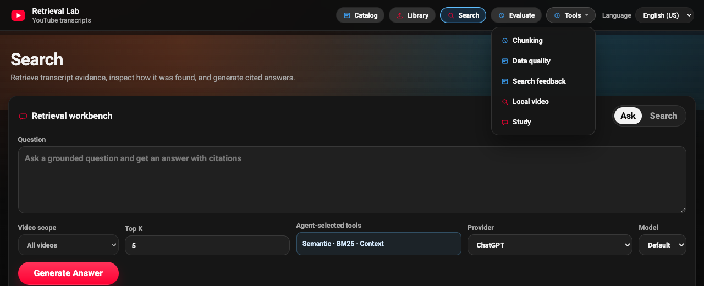

# Architecture

The lab is a single local Python process that serves both the HTTP API and the
browser UI. It stores everything on disk under `data/` and in the browser.

```text
Browser UI (local_preview/web), one shared nav (lab-nav.js)
  React shell (index.html): Library, Search, Study, Local video
  Pages: catalog, evaluation, chunking, evidence (Data quality), reviews (Search feedback)
      |  same-origin requests with session cookie + CSRF token
      v
local_preview/local_api.py  ── browser_boundary.py (Host/Origin/CSRF checks)
  ingestion jobs, search, ask, summaries, study, evaluation, OCR jobs
      |
      +── catalog_client.py                            read-only catalog proxy (optional)
      |
      +── retrieval_tools.py / agentic_retrieval.py   tool policy + decision trace
      +── grounded_answer.py                           citations, confidence, abstention
      +── eval_generator.py                            Codex CLI dataset drafts
      |
      v
multilingual/
  video_library.py   per-video records and canonical transcript segments
  text_processing.py chunking, embeddings (E5), tokenization (fugashi for Japanese)
  rag_engine.py      FAISS + BM25 retrieval, hybrid fusion
  reranker.py        opt-in cross-encoder reranking
  video_routing.py   multi-vector video shortlist for library-wide Ask
      |
      v
local files (data/, gitignored) and browser storage
```

## Search workbench flow

1. **Scope.** All indexed videos, chosen videos, or a catalog filter. For a
   catalog filter, the browser reads matching catalog items and keeps only the
   indexed videos among them; the result is sent as `video_ids`.
2. **Run A and Run B.** The same query runs twice through `POST /v1/search`
   with each run's strategy, mode, hybrid profile, reranker, and top K, and with
   `feedback_tuning: false` so stored labels cannot move the rankings.
3. **Compare and label.** The browser computes rank changes between runs and
   per-query Precision@K and nDCG@K from the labels for that query. Labels are
   saved with `POST /v1/feedback/search-review` and loaded back with
   `GET /v1/feedback/search-review?query=…`.

## Answer flow

1. **Scope.** The request targets selected videos, or all videos. For all
   videos, the multi-vector router ranks videos by identity, overview, and
   section vectors (dense aggregation plus lexical RRF) and keeps the top few.
2. **Retrieve.** Plain search runs dense, lexical, or hybrid retrieval. Agentic
   search chooses a tool, checks evidence sufficiency, may switch tools, and
   reads nearby context from the canonical transcript.
3. **Rank.** Fused candidates can be reranked by a cross-encoder, then adjusted
   by stored relevance feedback and diversified across the transcript.
4. **Answer.** The provider must return strict JSON with numbered citations.
   An evidence-sufficiency gate decides between `answered` and
   `insufficient_evidence`; the response includes confidence and the retrieval
   trace under `retrieval_details`.

## Frontend

The navigation is defined once in `local_preview/web/lab-nav.js`: Catalog,
Library, Search, Evaluate, and a Tools menu (Chunking, Data quality, Search
feedback, Local video, Study). The React shell imports it, and the standalone
pages render it with `renderLabNav()`; `e2e/shell-redesign.spec.ts` checks that
every page shows the same navigation.



`local_preview/react_shell/` is the React source for Library, Search, Study, and
Local video: `library.jsx` (Library), `workbench.jsx` (Search), `lab.jsx`
(shared helpers), and `App.jsx` (routing, the Answer flow, Study, and Local
video). `npm run
build:web` writes the bundle to `local_preview/web/assets/`, and CI fails if the
committed bundle does not match the source. The other pages are plain HTML and
JavaScript in `local_preview/web/`. Running the app does not require
Node.js.

## Data layout

| Location | Contents |
| --- | --- |
| `data/library/` | Library manifest and per-video records, including `full_transcript` segments |
| `data/index/` | Transcript FAISS indexes |
| `data/index/ocr/` | OCR FAISS indexes |
| `data/frames/`, `data/processed/` | Extracted local-video frames and OCR metadata |
| `data/runtime/` | Search feedback, ask history, ingest logs, review batches, curation artifacts, evaluation drafts |
| `data/cache/summaries/` | TLDR cache keyed by language, provider, model, and point count |
| Browser `localStorage` | Evaluation query sets, labels, and run snapshots |
| Browser `sessionStorage` | Study Studio run history for the current tab |

The canonical transcript is never replaced by derived views; chunk indexes and
router artifacts can be rebuilt from it.

## Boundaries

- **Network:** the server binds to `127.0.0.1`, rejects cross-origin mutations,
  and does not trust forwarded headers. See [browser security](../BROWSER_SECURITY.md).
- **Catalog:** the public app reads catalog records from a separate private
  service through `catalog_client.py`, which accepts only a fixed read-only
  projection from an explicit loopback URL. Cataloged items are never searchable
  or ingested because they were discovered. See the [catalog browser](catalog-browser.md).
- **YouTube:** ingestion uses transcripts, metadata, and timestamp links. It does
  not download video files.
- **Local-video OCR:** frame extraction and OCR accept local files you own or
  have permission to process. See the [OCR design](multimodal_ocr_design.md).
- **Library export:** `pipelines/export_library.py` writes stored evidence
  through a [versioned contract](contracts/youtube-library-export-v1.md) without
  fetching videos or loading models.
