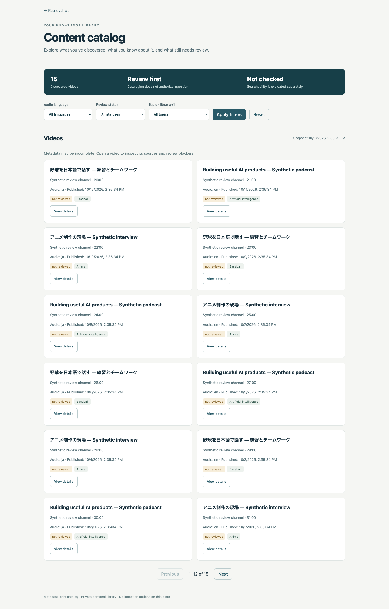
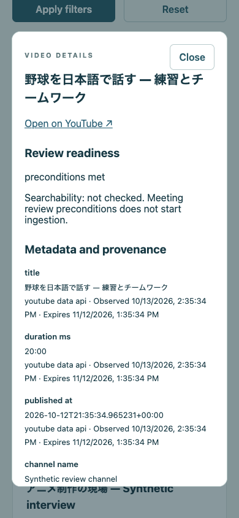

# Local catalog browser

Open **Settings → General → Catalog metadata** or visit `/catalog.html` on the local
server. Browse discovered videos by language, topic, or review status. Open a
record for its provenance and review blockers. Browsing requires no YouTube API key.

Library shows catalog status alongside indexed videos. In **Search → Compare**,
a catalog filter scopes retrieval to matching videos already in the local index.
Discovery alone does not index a transcript.

## Connect the optional catalog

Start the private catalog service separately on loopback with its schema 0008
catalog projection. Point the public app at its numeric loopback address and port:

```sh
export CONTENT_LIBRARY_CATALOG_URL=http://127.0.0.1:8100
python local_preview/local_api.py
```

Without the service, Catalog displays an unavailable state. Library and Search
can still use the local index. The public client provides read-only list and
detail views. It rejects private fields and clears displayed data when metadata
or permits expire. Review readiness records preconditions only. Keep both
services on loopback. See the [browser request boundary](../BROWSER_SECURITY.md).

## Validation

`pytest tests/test_catalog_client.py -q` covers URL/path/query constraints, local
client restrictions, projection rejection, capacity, redirects and real HTTP errors.
`pytest tests/ multilingual/tests/ -q` is the full regression suite.
`npm ci && npm run build:web` uses the lockfile and refreshes the checked-in bundle.

For opt-in browser verification, use a disposable private database with the synthetic
catalog fixture from the private service. The [browser check](../scripts/validate_catalog_flow.cjs)
lists the expected records, filter counts, and detail assertions. Start both services:

```sh
CATALOG_FLOW_URL=http://127.0.0.1:8000 \
  CATALOG_SCREENSHOT_DIR=/tmp/catalog-screenshots \
  node scripts/validate_catalog_flow.cjs
```

Optional `CHROME_EXECUTABLE` selects an installed Chrome. Default fixture count is
14; `CATALOG_FIXTURE_TOTAL=15` includes the expiring-observation test item. Checks
exercise actual services, not static hosting or mocked API responses. The screenshots
below contain synthetic data only. No ingestion or model-quality claim follows.



