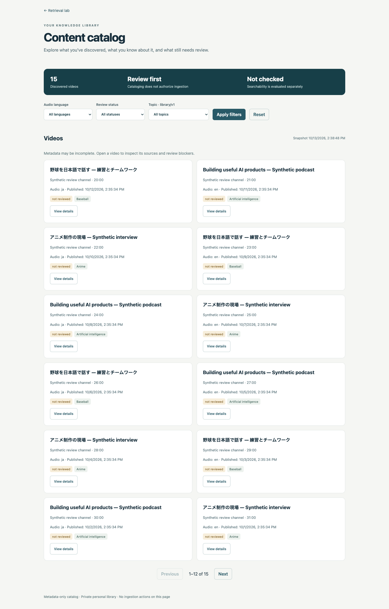
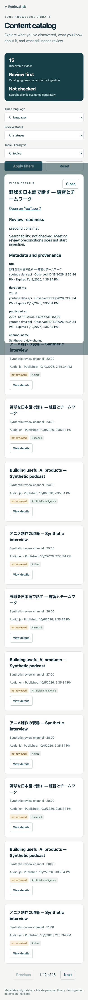

# Local catalog browser

Open **http://127.0.0.1:8000/catalog.html** after starting the real backend:

```sh
# Private service must run separately on loopback with catalog schema 0008.
export CONTENT_LIBRARY_CATALOG_URL=http://127.0.0.1:8100
python local_preview/local_api.py
```

The Catalog link in the app opens discovered video metadata, language/topic/status
filters, stable pagination, provenance and review blockers. These are catalog
records; searchability is explicitly not checked. There are no ingestion or review
write controls. No YouTube API key is needed to browse previously cataloged entries.
Missing private-service configuration produces an unavailable state.

The public repository owns only this read client and UI. The private library owns
PostgreSQL storage, discovery adapters, review evidence, ontology, and evaluation.
The client accepts only a dedicated safe projection at fixed list/detail paths.
Reviewer identities, reasons, artifact references/hashes, source configuration and
transcript text are rejected. The upstream must be an explicit numeric loopback URL
with a port; redirects and environment HTTP proxies are disabled. The client has a
5-second caller deadline, 3-second socket timeout, 2 MB response cap and four worker
slots. Responses are no-store. A slow worker retains its bounded slot until it ends.
This is an operator-local interface without multiuser authentication; do not expose
it through a tunnel or network listener.

Ontology filters use explicit `library/v1` reviewed terms. They do not change live
semantic ranking. Unknown and expired metadata remain explicit. At the earliest
metadata or permit expiry, displayed data is cleared and reloaded; failed reloads
do not restore stale values. Readiness is a snapshot of reviewed preconditions,
never authorization to fetch or ingest a transcript.

## Validation

`pytest tests/test_catalog_client.py -q` covers URL/path/query constraints, local
client restrictions, projection rejection, capacity, redirects and real HTTP errors.
`pytest tests/ multilingual/tests/ -q` is the full regression suite.
`npm ci && npm run build:web` uses the lockfile and refreshes the checked-in bundle.

For opt-in browser verification, use a disposable private database with the synthetic
fixture described in the private repo's checks report. Start both real services:

```sh
CATALOG_FLOW_URL=http://127.0.0.1:8000 \
  CATALOG_SCREENSHOT_DIR=/tmp/catalog-screenshots \
  node scripts/validate_catalog_flow.cjs
```

Optional `CHROME_EXECUTABLE` selects an installed Chrome. Default fixture count is
14; `CATALOG_FIXTURE_TOTAL=15` includes the expiring-observation test item. Checks
exercise actual services, not static hosting or mocked API responses. The screenshots
below contain synthetic data only. No ingestion or model-quality claim follows.



