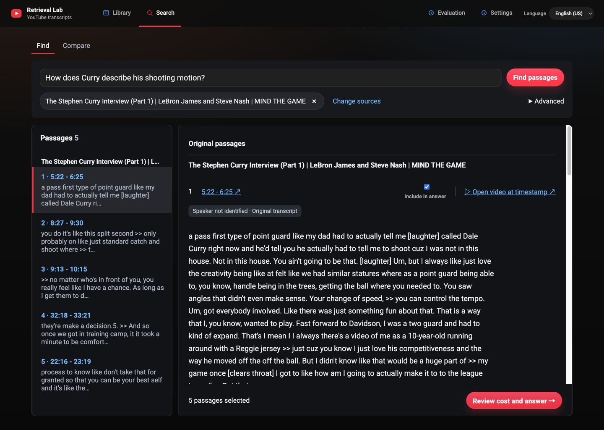
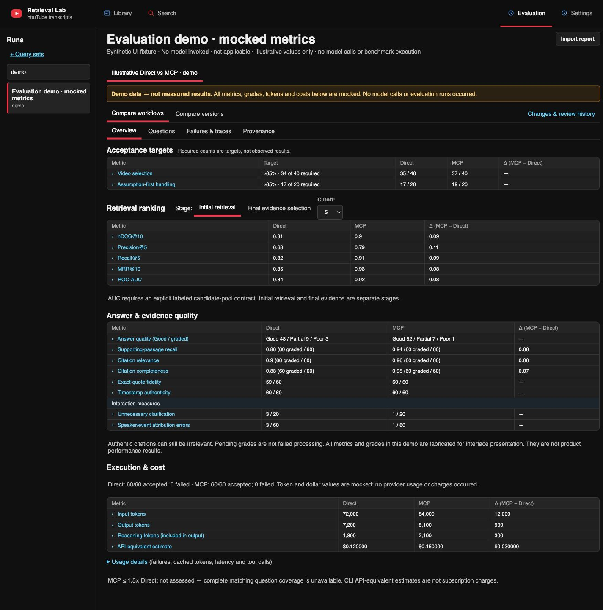

# Evidence workspace UI review

Separate AI coding agents handled implementation and review of the selected
transcript-reader, Evaluation and Settings direction. The review compared the
implementation against the approved mocks, current source code and fresh
local-browser evidence. The initial review found
four P2 issues; the follow-up approved the reviewed local workflow with **no
remaining P1/P2 findings**. This is UI/workflow acceptance, not a new answer-quality
or retrieval-accuracy result.

## Findings and corrections

| Initial finding | Correction and evidence |
| --- | --- |
| Recorded validation reasons were lost during import. | Preserve the exact reason, rejected attempted output and ranked retrieval metadata. The real saved case now explains an inexact canonical quote rejection; rejected output is never displayed as an accepted answer. |
| Metric links opened empty/unfiltered questions and retained stale scope. | Use explicit contributor IDs, explain missing mappings before navigation, clear stale state, group workflow attempts by question and scope version views to the selected workflow. |
| Baseline compatibility checked the wrong profile and dropped supplied identity fields. | Check candidate model/effort/workflow and scoped provenance conflicts. Preserve supplied identities; missing hashes remain unavailable. |
| Rerendering lost keyboard focus and selected semantics. | Restore focus to the originating control or intended Questions destination, expose selected states and distinguish duplicate controls. Enter-key Overview and Failures transitions were verified in the browser. |

Follow-up review also corrected pending grades qualifying for the cost gate,
dropped cost/distribution metadata and mismatched failure-action counts. These
paths have offline regression coverage.

Presentation changes group transcript sources, enlarge original text, format
metrics/counts/currency, separate interaction measures, show coverage and cost
basis near costs, and expose readable timestamps without changing canonical URLs.
Evidence cards identify sources; long traces and references use disclosures.
Recorded Good/Partial/Poor distributions render when supplied, while missing
historical grades remain pending.

## Screenshots

### Find: original evidence and explicit selection

The real local backend retrieves the Curry development question. Full original
text, unknown-speaker labels, source links and passage selection remain visible.
This is a workflow example, not a judged answer.

### Evaluation: populated demo metrics

At the user's request, the current screenshot uses a [synthetic demo report](../examples/evaluation-demo.json)
so key metrics are populated. A prominent banner identifies all values as mocked.
The screenshot is UI documentation, not evidence that either acceptance target
or an accuracy/cost result was achieved. The earlier independent review inspected
real saved-report states; existing snapshots and frozen results remain unchanged.
No transcripts, frozen questions, answers or labels are included in the demo.

## Validation and limits

- Final pre-PR offline Python suites: **466 passed**, with three existing SWIG warnings.
- Final pre-PR combined browser run: **34 passed** across the five CI specs,
  including the completed timestamp/reference polish.
- The preceding AI review also inspected the focused dashboard regression
  (**7 passed**) and reader regression (**8 passed**) after their respective fixes.
- Production frontend build, JavaScript syntax, Python fatal checks and whitespace
  checks passed. Browser console errors were empty for checked states.
- Original research files, frozen artifacts and existing saved-report snapshots
  were checked for unchanged hashes. No provider calls, web search, paid evaluation,
  ingestion or frozen rerun occurred.

The follow-up verified the captured desktop flow and selected keyboard transitions.
It did not independently verify every mobile or Settings state, live answer
generation/ingestion, complete assistive-technology behavior or a compatible
historical-baseline success path. Synthetic offline fixtures cover compatible and
incompatible comparison paths absent from the historical reports. Slight capture
cropping limits pixel-perfect full-viewport comparisons. The public checkout includes the synthetic demo fixture; real local evaluation
reports remain excluded. Import your own supported report for actual results.

## Navigation follow-up

After the AI review, user feedback moved Library and Search beside the brand,
with Evaluation and Settings kept as right-side utilities. Shared header rules
keep the primary anchor, typography and active underline consistent across React
and standalone pages. Mobile run history stays within its own scroll area.
This follow-up passed **20** targeted shell/Evaluation/Library browser checks at
desktop and narrow widths plus the frontend build; it was not independently
re-reviewed by the review agent. The screenshots above show the shared brand, subtitle and navigation. The
reader offers a language picker; the saved-report dashboard currently uses
English review labels and does not expose an unsupported locale control.

## Populated metrics screenshot

The demo fixture and persistent `source_type: demo` disclosure were added after
the independent review. The aggregate-only fixture has no question-level evidence
and cannot establish the matched-case cost gate. Its mocked AUC includes an
explicit illustrative candidate-pool description. **15 report tests and 9 dashboard
tests passed**, including demo-label persistence and populated ranking metrics.
This documentation-only data was not independently re-reviewed by the review agent.

## README review follow-up

Public review feedback clarified browser versus file-backed report storage,
Settings and Query sets navigation, and the AI-agent review roles. The illustrative
Evaluation screenshot now sits separately from measured evaluation status, with
an explicit lead-in and an explanation of optional companion-report imports.
The refreshed screenshot restores the shared brand subtitle; the dashboard's
English-only review labels do not expose an unsupported language picker.

The follow-up passed **38 offline browser checks**, the frontend build, local
Markdown-link checks and frozen/source/report hash checks. An isolated CI
bootstrap audit passed after explicitly upgrading setuptools under the security
constraint; no advisory was suppressed. This follow-up has not received another
independent agent review. No model calls or evaluation runs were made.
