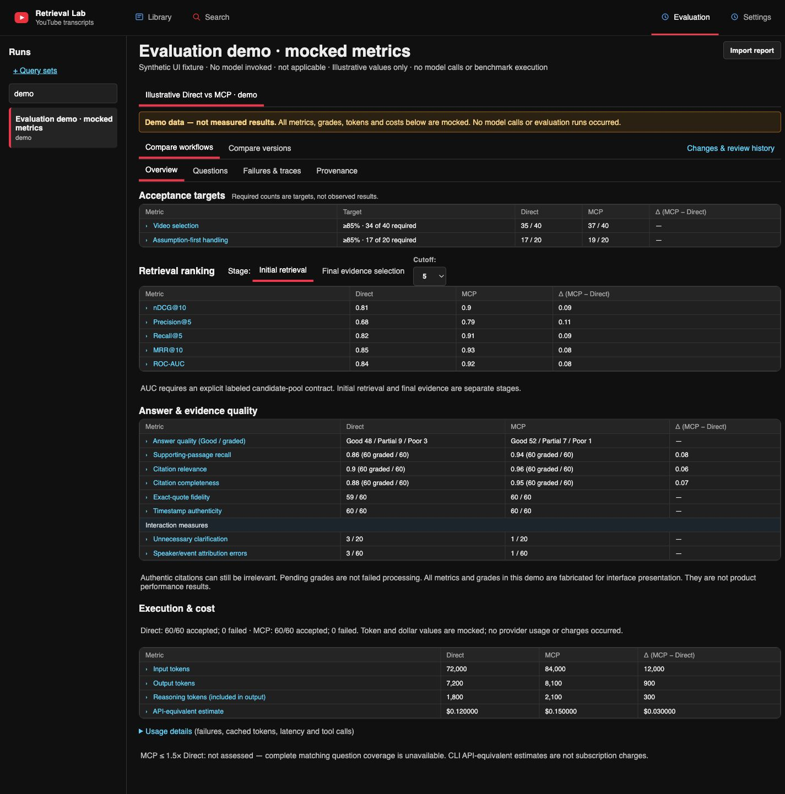
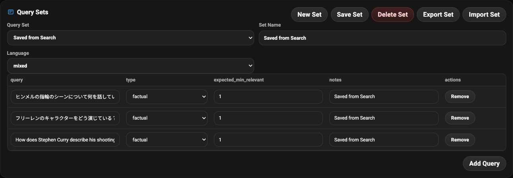
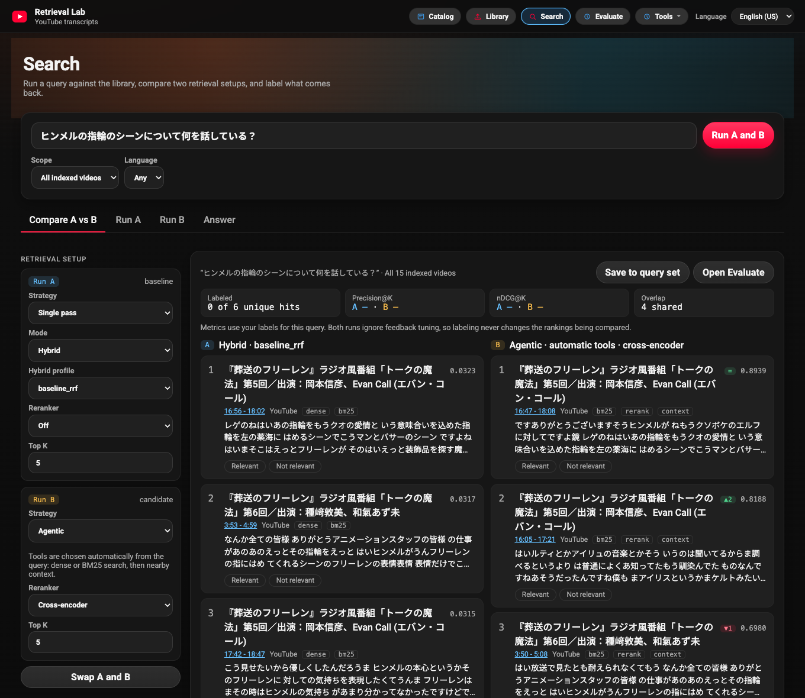

# Evaluation

The lab measures retrieval in three ways: an offline benchmark that needs no
network or keys, an interactive workspace for labeling real results, and tooling that
turns reviewed evidence into reusable datasets.

**Illustrative UI demo — not measured benchmark results.**



This screenshot uses [mocked demonstration data](examples/evaluation-demo.json),
not measured evaluation results. Import that JSON through **Import report** to
reproduce the populated view. Its values, grades, tokens, costs and AUC candidate
pool description are illustrative; no model or benchmark was run. Real reports
continue to show missing grades and measurements as unavailable. The dashboard
uses English review labels; the bilingual reader and Query sets workbench also
provide a language picker. Original transcript quotations retain their language.

## Saved run review

**Evaluation** opens the local run-review dashboard at `/evaluation.html`.
Import an explicitly selected JSON report to review immutable local snapshots;
opening a report never launches a model or grading job. **+ Query sets** in the
Evaluation sidebar opens the existing dataset workspace, with its browser storage
and saved runs intact. Imported reports are files under
`data/runtime/evaluation_reports/`; clearing browser storage does not delete them.

Supported imports include the public offline benchmark, the local subscription
review envelope, and API held-out reports. Real reports remain in ignored runtime
data and are not bundled with the app. The public app needs no private package.
Reports from the optional private MCP companion can also be reviewed without
installing or running that companion. Only supported review fields are retained;
unknown measurements remain unknown.

The overview separates acceptance targets, initial/final retrieval ranking,
answer/citation quality, and execution/cost. Precision, Recall, MRR and nDCG are
shown only when recorded for that report and stage. ROC-AUC needs an explicit
candidate-pool contract. Synthetic fixture metrics never fill gaps in a real run.
Semantic passage recall and citation support require reviewed labels; exact text
and timestamp checks alone do not establish relevance.

CLI API-equivalent estimates are not subscription charges or provider invoices.
Reasoning tokens are already included in output. Failed-attempt inclusion follows the recorded cost basis, and absent usage is not zero. Version deltas require compatible
corpus, dataset, criteria, model/effort, stage and cutoff metadata; missing IDs
cannot certify comparability. Two acceptance targets are separate and use the
report's recorded denominators rather than assuming every dataset is Frozen60.

Metric drilldowns expose recorded question answers, canonical citations and safe
tool summaries. Where a report lacks metric-contribution links, the UI says so
before navigation rather than inventing affected questions. Question views group recorded workflow attempts by question and version comparisons scope them to the selected workflow.

## Offline benchmark

```bash
python -m evals.runner \
  --dataset evals/datasets/jp_core_v1.example.jsonl \
  --config evals/configs/baseline.yaml \
  --out evals/reports/latest
```

The runner needs no network access, provider keys, or model downloads. It
compares dense, lexical, baseline hybrid, optimized hybrid, and agentic retrieval,
and writes a leaderboard, per-query results, and failures to the gitignored
`evals/reports/`.

Offline benchmark runs record `scoring_version: span_overlap_v1`, and the Evaluation dashboard shows deltas only for runs with matching, recorded scoring versions.

| Run                         | Precision@5 | Recall@5 | MRR@10 | nDCG@10 |
| --------------------------- | ----------: | -------: | -----: | ------: |
| `dense`                     |      0.2000 |   1.0000 | 0.4896 |  0.6193 |
| `lexical`                   |      0.2000 |   1.0000 | 0.9375 |  0.9539 |
| `hybrid_baseline` (default) |      0.2000 |   1.0000 | 0.7917 |  0.8452 |
| `optimized_hybrid`          |      0.2000 |   1.0000 | 1.0000 |  1.0000 |
| `agentic`                   |      0.2000 |   1.0000 | 0.9375 |  0.9539 |

These numbers come from an eight-query Japanese fixture with hand-authored dense
scores. They catch regressions in the harness and scoring; they do not show that
any strategy is better on real embedding indexes. The dataset schema, metric
definitions, and caveats are in [`evals/README.md`](../evals/README.md).

The [video-routing evaluator](../evals/video_routing/README.md) scores the
video-selection stage separately, using synthetic records whose labels stay
hidden from the router.

## Label in Search

Search compares Run A and Run B on one query. Mark each result **Relevant** or
**Not relevant**; the label is saved for that query and chunk, appears in both
columns, and updates the per-query Precision@K and nDCG@K for both runs. Both
runs skip feedback tuning, so labeling does not change the rankings being
compared. **Save to query set** adds the query to the **Saved from Search**
query set in Evaluate so it can be re-run later.





## Evaluate page

Open **Query sets** from Evaluation (`http://127.0.0.1:8000/evaluation-workbench.html`) to:

- create, import, and export query sets
- run retrieval and label results with reason codes
- score runs with Precision@K, Recall@K, MRR, and nDCG@K
- compare runs with aggregate and per-query deltas

Query sets, labels, and run snapshots are stored in browser `localStorage`.
Labels given in Search are stored separately in `data/runtime/`, feed the
server's default feedback tuning, and are listed under **Settings → Search
feedback**.

## Draft a dataset with Codex CLI

The Query sets workbench can turn one to three indexed transcripts into a six-case
retrieval draft. Install the Codex CLI and run `codex login` first.

- Each proposal stays a draft until you approve, edit, or reject it.
- The local API runs one ephemeral Codex pass in a read-only sandbox, validates
  every cited chunk against the selected videos, and does not forward provider
  API keys.
- Finalizing creates a browser query set and a JSONL dataset under the
  gitignored `data/runtime/eval_generator/`.
- `YT_RAG_CODEX_BIN` selects a CLI executable; `YT_RAG_CODEX_MODEL` overrides
  its model.


## Review drafted labels

Open **Label review** from the Evaluation sidebar. Choose **Summary key
points**, an indexed video with a stored transcript, and an output language
tag such as `en` or `ja`. Drafting sends up to 150,000 characters of numbered
transcript lines. It defaults to `claude_cli` with `opus`. Set
`YT_RAG_LABEL_DRAFTER=codex_cli` to use Codex, or set
`YT_RAG_LABEL_DRAFTER_MODEL` to override the selected model. Saved provenance
records the provider, model and CLI version.

Use the excerpt and timestamp link to review each item. Approve, edit, or
reject every item before finalizing. At least one item must be accepted.
Context is tied to the transcript fingerprint captured when the draft was
created. The context endpoint reports a conflict if that transcript changes.

Drafts are saved under `data/runtime/label_drafts/drafts/`. Finalizing writes
accepted labels to `data/evaluation/labels/summary_keypoints/` as JSONL. Each row
includes the source ID, fingerprint, review decision, provenance, and onset and
span timestamps in seconds. The matching manifest records the JSONL SHA-256
and counts for each review decision. Use the manifest to identify completed
datasets.

Choose **Episode sections** to draft topic boundaries and titles with Codex
from numbered transcript lines. The review form accepts title and boundary
edits in seconds. Finalized rows under `data/evaluation/labels/sections/`
contain `title`, `start` and `end` with the same source and review provenance.
The Codex model uses its usual default unless a compatible
`YT_RAG_LABEL_DRAFTER_MODEL` override is set.

### Episode key areas API

`POST /v1/summaries/key-areas` accepts `source_id` or `video_id`, plus
optional `language` (`en` by default, or `ja`), `provider` and `model`.
Provider and model defaults follow transcript summaries.

The version 1 response contains `overview.tldr` and `sections`. Each section
has `title`, `summary`, inclusive `start_line` and `end_line`, a time span in
seconds, and `key_points`. Each key point has `text`, `evidence_lines`,
individual `evidence` time spans, `speakers`, an overall `start` and `end`,
and a playback `url`. Sections partition the numbered transcript. Their
timestamps preserve caption gaps and overlaps. An empty `speakers` array
means no proposed name was supported by its cited lines or their turn labels.

`quality` reports the share of proposed citation references that fall in range,
the share of transcript lines covered, counts of boundary repairs and discarded
points, and `anchor_mode: "line_ids"`. Results are cached under
`data/cache/key_areas/<source_id>.json` by version, language, provider, model,
and transcript fingerprint. The response indicates cache reuse in `cached`.

### Collection summaries API

`POST /v1/summaries/collection` accepts `source_ids` (2–12 distinct indexed
IDs), `language` (`en` or `ja`), an optional `focus` string, `provider`, and
`model`. It reuses cached key areas and clusters section embeddings at cosine
similarity 0.80. Up to eight clusters are ranked by distinct source count, then
total section duration. Each theme retrieves up to eight hybrid transcript
matches within the selection. The focus guides synthesis over that evidence.

The response includes `overview`, `themes`, and an `evidence_catalog`. A theme
has `title`, `summary`, and `perspectives`. Each perspective contains a
`source_id`, a `stance` (`agrees`, `differs`, `adds`, or `only_here`), a
`statement`, and `citations` such as `["E1"]`. Resolve each ID against
`evidence_catalog[].citation_id` for its transcript excerpt, timestamp in seconds,
and playback URL. The server drops references outside the theme or the
perspective's source, then omits perspectives that have no valid citation.
`coverage` reports selected and cited source counts and the share of proposed
references that pass validation. The share is zero when there are no references.

### Speech-to-text evaluation

In **Label review**, choose **STT reference excerpts** or **Timestamp landing**
and an indexed audio source. Each task samples up to 10 stored segments with a
configurable seed (default 42). Play the audio in the review pane. For a
reference excerpt, approve the draft if it matches the audio or edit the
transcript. For timestamp landing, approve if playback lands within a second
of the expected onset, or record the actual onset minus the sample start in
seconds. Reject unusable items. Finalization writes the accepted rows and a
digest manifest under `data/evaluation/labels/<task>/`. Reference rows retain both
the corrected text and the engine draft used to start the review.

```sh
.venv/bin/python -m evals.stt.runner \
  --references data/evaluation/labels/stt_reference/dataset_EXAMPLE.manifest.json \
  --landing data/evaluation/labels/ts_landing/dataset_EXAMPLE.manifest.json \
  --drift-pairs data/stt/paired-timelines.json \
  --jobs data/stt/jobs.json \
  --out evals/reports/stt.json
```

Supply any combination of inputs. Reference scores compare each engine draft to
the reviewed excerpt and pool edit counts by engine, model, and language.
Japanese reports character error rate because the runner does not segment
Japanese into words. Report sample sizes alongside the scores and account for
the reviewers having seen the engine draft.

For drift, supply explicit pairs of the same published content as a JSON
`pairs` array. Each pair has a `pair_id`, `language`, `caption_words`, and
`stt_words`. Each word array contains `{"word":"kite","start":1.25}` rows in
timestamp order. Use the same timeline and word segmentation for both streams.
Flatten the saved `stt_words.json` segments for the STT stream when word timing
is available. The report gives the STT-minus-caption offsets at unique shared
three-word anchors, their median, and IQR. A pair with no matching anchors
reports an unavailable median and IQR.

For real-time factor (RTF), save a `GET /v1/ingest/jobs` response before stopping
the server. RTF uses engine wall time divided by audio duration. It includes
engine startup on cold jobs and excludes queue time, downloading, and indexing.
Reused transcripts have no timing sample.

### Cross-source labels and evaluation

In **Label review**, choose **Multi-source questions** or **Collection themes**
and select 2–12 sources. Codex drafts both tasks from numbered transcript
excerpts. Finalized JSONL rows include `selected_source_ids`, source fingerprints,
and owner review provenance. Question labels include `question`, `required_facts`,
and timestamped `gold_spans` across two or more sources. Theme labels include
`title` and `source_ids` for the sources that discuss the theme.

`evals.summary.cross_source` exposes `generate_ask_prediction` and
`generate_collection_prediction`. Each takes an injected callable accepting the
request fields as keyword arguments and returning the corresponding API response
dictionary. Ask generation uses library-wide `multi_vector` routing. Collection
generation uses the label's selected sources and defaults to the question as
focus when a question label is supplied.

Use `score_ask` and `score_collection` to measure the fraction of gold sources
cited and the fraction of gold timestamp spans matched by a same-source citation
under the P1 overlap rule. Pass question gold spans to score a focused collection
on the same evidence task. Pass reviewed theme rows and an explicit `judge_llm`
to `score_collection` for `theme_recall` and `stance_source_precision`.
The judge compares theme meanings and grades each perspective against its own
cited excerpts in the context of the theme. A metric is `null` when its
denominator is empty or it requires a judge and none was supplied.

## Summary evaluation

The summary evaluator measures the coverage of owner-reviewed key points, where
summaries take a reader in the transcript, and whether the cited passage supports
each claim. `score` and `report` operate on saved files and run offline.

```bash
.venv/bin/python -m evals.summary.runner report \
  --gold evals/datasets/summary_synthetic_v1.gold.jsonl \
  --manifest evals/datasets/summary_synthetic_v1.manifest.json \
  --predictions evals/fixtures/summary_synthetic_v1.predictions.jsonl \
  --out evals/reports/summary-synthetic
```

The bundled English and Japanese fixtures use invented transcripts and
hand-written predictions and judgments. Add
`--judgments evals/fixtures/summary_synthetic_v1.judgments.jsonl` and use a fresh
output directory to exercise the judged report offline.

Keep source transcripts, reviewed gold, generated predictions, judge decisions
and reports under gitignored `data/` or `evals/reports/`. A gold JSONL row
declares `"schema": "summary-gold/v1"` and contains `source_id`, `language`
(`en` or `ja`), `source_fingerprint`, `duration_s`, and `key_points`.
Optional `sections` contain `start` and `title` and can retain the reviewed
`end` from finalized Episode sections labels. When assembling gold from
finalized **Summary key points** labels, group them by source, retain the
transcript fingerprint, and map each label's `span_start` and `span_end` to
a `{start,end}` entry in `spans`. Each point retains its `id`, reviewed
`text`, `importance` from 1 to 3, and `onset` in seconds. Put the exact gold
file SHA-256 in the manifest's `sha256` field. The evaluator checks that digest
and verifies the stored transcript fingerprint before generation or judging.

Use `generate --gold … --manifest … --provider … --out predictions.jsonl`
against the stored library. The provider choices are `codex_cli`, `claude_cli`,
`chatgpt`, `claude` and `sakana`. `--model` and `--system` can identify
the run. Use `--system key_areas` to generate episode sections and score their
flattened, cited key points. Prediction rows record the model, provider, output language, cache hit
and CLI version when available. Older cache entries can lack item-level
timestamp provenance. Use `--data-dir` to select the stored library or
`--transcripts` to supply a JSON file with the same shape as the
[synthetic transcript fixture](../evals/fixtures/summary_synthetic_v1.json).

Use `judge --gold … --manifest … --predictions … --judge claude_cli --out judgments.jsonl`
to opt into semantic judging. The other judge choices are `codex_cli`,
`claude` and `chatgpt`. Each run first makes one-to-one semantic matches,
then grades faithfulness. The faithfulness window is the anchored segment plus
45 seconds on either side. A fallback timestamp uses a window centered on its
start. For a matched prediction, the window also includes the transcript lines
of the matched gold point's spans, capped at 600 seconds from the first span
start (`window_policy: anchor_plus_matched_gold_v1`). The judge checks each
substantive claim against the supplied lines. A claim missing from those lines
caps the item at partial, even if the episode states it elsewhere
(`prompt_version: strict_claims_v2`). Speaker attribution and minor
transcription variants of a name are not graded. Judgment rows bind to the
exact gold and prediction rows and record judge provenance, the window policy,
the prompt version and the excerpts used for faithfulness. Scoring rejects
judgments that mix window policies or prompt versions.

The CLI providers use existing local subscription logins. The Codex default
model is `gpt-6-luna` (`YT_RAG_CODEX_LLM_MODEL`) and the Claude default is
`sonnet` (`YT_RAG_CLAUDE_CLI_MODEL`). Set `YT_RAG_CODEX_BIN` or
`YT_RAG_CLAUDE_BIN` to override discovery. Claude Code must support
`--safe-mode` and the isolation flags used by the runner. Generation runs in
temporary working directories with a sanitized environment and a five-minute
timeout.

| Metric | Calculation |
| --- | --- |
| `anchor_resolution_rate` | Resolved anchors divided by items with known timestamp provenance. |
| `ts_hit@15s`, `ts_hit@30s`, `ts_mae_s` | Inclusive hit rates and mean absolute error between predicted start and the matched point's onset. Judgments supply the matches when present. Otherwise the timestamp proxy makes a deterministic one-to-one pairing within 30 seconds of a gold span. |
| `keypoint_span_recall@30s` | Share of gold points with any predicted start between 30 seconds before a span begins and 30 seconds after it ends. A prediction may cover multiple points for this proxy. |
| `duplicate_anchor_rate` | Resolved anchors beyond the first use of the same start/end pair, divided by resolved anchors. |
| `language_match_rate` | Share of item texts matching the gold language by Japanese or Latin script. Mixed script containing Japanese characters counts as Japanese. |
| `keypoint_recall_w`, `keypoint_precision` | Importance covered divided by total gold importance, and matched items divided by predicted items. Both require judge decisions. |
| `faithfulness_rate`, `partial_rate` | Items graded supported or partial, respectively, divided by all judged items. |
| `boundary_f1@15s`, `boundary_f1@30s` | Compare internal section start times in seconds, excluding each plan's first section. Greedily pair the closest boundaries within the tolerance, one-to-one. F1 is twice the match count divided by the total boundary count, or 1 if both counts are zero. |
| `window_diff` | Share of windows with different gold and predicted boundary counts. Use one-second bins and a window width of half the mean gold section length, rounded down and clamped to fit the timeline. |
| `section_coverage` | Union of predicted section time spans divided by source duration. |

Results contain per-source counts and per-system micro-aggregates. Rates
with a zero denominator are unavailable. Span proximity measures timestamp
coverage. Meaning and claim support require semantic review.
Boundary metrics require gold and predicted sections. Time coverage only
requires predicted sections.

`score` writes `results.json`. `report` also writes `summary.md` and a
fixed-seed `judge_audit_sample.jsonl` containing up to 20 individual decisions.
Both commands require a fresh results path. To review a sample, open **Label
review**, choose **Judge audit**, and import that JSONL file. Mark every decision
**Agree** or **Disagree** and finalize. The manifest under
`data/evaluation/labels/judge_audit/` records the sample digest and agreement
rate. Publish judged numbers only if owner agreement on the audit sample is
at least **0.85**. The sample contains only machine decisions and their review
inputs until an owner records their judgments.

### Summary baseline

The owner approved this baseline and its regression floors on 2026-11-19. A
later run on the same gold that scores below a floor counts as a regression.
The gold, predictions and judgments stay private. The digests identify the
exact files.

| Item | Value |
| --- | --- |
| Gold | 9 owner-reviewed sources (6 English, 3 Japanese, 10.6 hours), 71 key points (48 English, 23 Japanese). SHA-256 `70c5118f0075f9b515fef30b4ea19d3e114ecd6711293f5e371f35ef185082d2` |
| System | `codex_cli:gpt-6-luna` (codex-cli 0.166.0), 5 items per source, 45 items. Predictions SHA-256 `0e413bb4c6d5204f52c0158e7e243cb92940bc22fe5ccef4402d1d22207aa415` |
| Judge | `claude_cli:sonnet` (Claude Code 2.1.283), `anchor_plus_matched_gold_v1`, `strict_claims_v2`. Judgments SHA-256 `80b2a40f5e63361063dba8b67a4da4898f55fe281e55f6885d962b75bdf01877` |
| Judge audit | The owner agreed with 18 of 20 sampled decisions (0.90): 10 of 10 matches and 8 of 10 faithfulness grades. In both disagreements, the judge graded an item supported when some of its claims were absent from the supplied lines. The strict prompt was written in response. On the same sample it agrees with all 20 owner decisions, but that recheck is not an independent estimate. |

| Metric | Baseline | Regression floor | Goal |
| --- | ---: | ---: | ---: |
| `faithfulness_rate` | 0.556 | 0.50 | 0.90 |
| `ts_hit@30s` | 0.581 | 0.50 | 0.80 |
| `keypoint_recall_w` | 0.634 | 0.58 | — |
| `keypoint_precision` | 0.956 | 0.90 | — |
| `anchor_resolution_rate` | 0.733 | 0.70 | — |
| `ts_hit@15s` | 0.488 | — | — |
| `ts_mae_s` | 382 | — | — |
| `keypoint_span_recall@30s` | 0.606 | — | — |
| `partial_rate` | 0.422 | — | — |
| `duplicate_anchor_rate` | 0.000 | — | — |
| `language_match_rate` | 1.000 | — | — |

The floors sit a few points below the baseline. One item out of 45 moves a
rate by about 0.02, and repeated generations vary. The goals are targets, not
gates.

## Assisted labeling

`local_preview/review_agent_workflow.py` batches live `/v1/search` results,
renders reviewer prompts, builds adjudication inputs, and applies approved labels
through `/v1/feedback/search-review`. The commands are in the
[local app guide](../local_preview/README.md#assisted-labeling-workflow).

## Data quality (evidence curation)

`pipelines/curate_evidence.py` turns ingested transcript chunks into local
evidence artifacts with heuristic quality signals, topic tags, retrieval
eligibility, and a quality report. It calls no external services.

```bash
python pipelines/curate_evidence.py \
  --dataset-id demo_transcript_evidence \
  --dataset-version v1 \
  --language ja \
  --limit 200
```

Inspect the output under **Settings → Data quality** (`http://127.0.0.1:8000/evidence.html`).

## Limits

- Labels come from a single reviewer; inter-rater agreement and adjudication UI
  are not implemented.
- Answer quality (citation precision, faithfulness, abstention correctness) is
  not yet scored.
