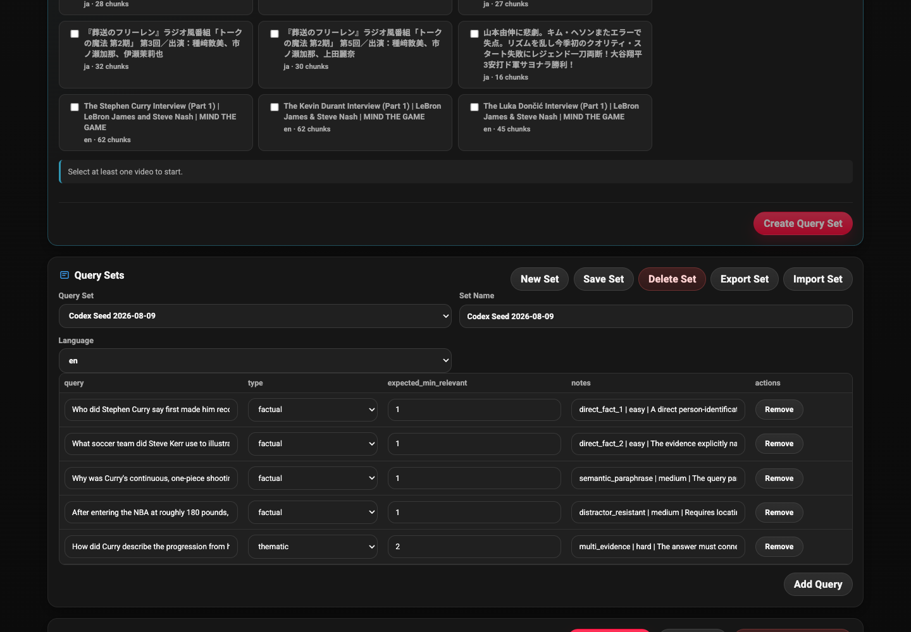

# Evaluation

The lab measures retrieval in three ways: an offline benchmark that needs no
network or keys, an interactive workspace for labeling real results, and tooling that
turns reviewed evidence into reusable datasets.

**Illustrative UI demo — not measured benchmark results.**


This screenshot uses [mocked demonstration data](examples/evaluation-demo.json),
not measured evaluation results. Import that JSON through **Import report** to
reproduce the populated view. Its values, grades, tokens, costs and AUC candidate
pool description are illustrative; no model or benchmark was run. Real reports
continue to show missing grades and measurements as unavailable. The dashboard
uses English review labels; the bilingual reader and Query sets workbench also
provide a language picker. Original transcript quotations retain their language.

## Saved run review

**Evaluation** opens the local run-review dashboard at `/evaluation.html`.
Import an explicitly selected JSON report to review immutable local snapshots;
opening a report never launches a model or grading job. **+ Query sets** in the
Evaluation sidebar opens the existing dataset workspace, with its browser storage
and saved runs intact. Imported reports are files under
`data/runtime/evaluation_reports/`; clearing browser storage does not delete them.

Supported imports include the public offline benchmark, the local subscription
review envelope, and API held-out reports. Real reports remain in ignored runtime
data and are not bundled with the app. The public app needs no private package.
Reports from the optional private MCP companion can also be reviewed without
installing or running that companion. Only supported review fields are retained;
unknown measurements remain unknown.

The overview separates acceptance targets, initial/final retrieval ranking,
answer/citation quality, and execution/cost. Precision, Recall, MRR and nDCG are
shown only when recorded for that report and stage. ROC-AUC needs an explicit
candidate-pool contract. Synthetic fixture metrics never fill gaps in a real run.
Semantic passage recall and citation support require reviewed labels; exact text
and timestamp checks alone do not establish relevance.

CLI API-equivalent estimates are not subscription charges or provider invoices.
Reasoning tokens are already included in output. Failed-attempt inclusion follows the recorded cost basis, and absent usage is not zero. Version deltas require compatible
corpus, dataset, criteria, model/effort, stage and cutoff metadata; missing IDs
cannot certify comparability. Two acceptance targets are separate and use the
report's recorded denominators rather than assuming every dataset is Frozen60.

Metric drilldowns expose recorded question answers, canonical citations and safe
tool summaries. Where a report lacks metric-contribution links, the UI says so
before navigation rather than inventing affected questions. Question views group recorded workflow attempts by question and version comparisons scope them to the selected workflow.

## Offline benchmark

```bash
python -m evals.runner \
  --dataset evals/datasets/jp_core_v1.example.jsonl \
  --config evals/configs/baseline.yaml \
  --out evals/reports/latest
```

The runner needs no network access, provider keys, or model downloads. It
compares dense, lexical, baseline hybrid, optimized hybrid, and agentic retrieval,
and writes a leaderboard, per-query results, and failures to the gitignored
`evals/reports/`.

| Run                         | Precision@5 | Recall@5 | MRR@10 | nDCG@10 |
| --------------------------- | ----------: | -------: | -----: | ------: |
| `dense`                     |      0.2000 |   1.0000 | 0.4896 |  0.6193 |
| `lexical`                   |      0.2000 |   1.0000 | 0.9375 |  0.9539 |
| `hybrid_baseline` (default) |      0.2000 |   1.0000 | 0.7917 |  0.8452 |
| `optimized_hybrid`          |      0.2000 |   1.0000 | 1.0000 |  1.0000 |
| `agentic`                   |      0.2000 |   1.0000 | 0.9375 |  0.9539 |

These numbers come from an eight-query Japanese fixture with hand-authored dense
scores. They catch regressions in the harness and scoring; they do not show that
any strategy is better on real embedding indexes. The dataset schema, metric
definitions, and caveats are in [`evals/README.md`](../evals/README.md).

The [video-routing evaluator](../evals/video_routing/README.md) scores the
video-selection stage separately, using synthetic records whose labels stay
hidden from the router.

## Label in Search

Search compares Run A and Run B on one query. Mark each result **Relevant** or
**Not relevant**; the label is saved for that query and chunk, appears in both
columns, and updates the per-query Precision@K and nDCG@K for both runs. Both
runs skip feedback tuning, so labeling does not change the rankings being
compared. **Save to query set** adds the query to the **Saved from Search**
query set in Evaluate so it can be re-run later.


## Evaluate page

Open **Query sets** from Evaluation (`http://127.0.0.1:8000/evaluation-workbench.html`) to:

- create, import, and export query sets
- run retrieval and label results with reason codes
- score runs with Precision@K, Recall@K, MRR, and nDCG@K
- compare runs with aggregate and per-query deltas

Query sets, labels, and run snapshots are stored in browser `localStorage`.
Labels given in Search are stored separately in `data/runtime/`, feed the
server's default feedback tuning, and are listed under **Settings → Search
feedback**.

## Draft a dataset with Codex CLI

The Query sets workbench can turn one to three indexed transcripts into a six-case
retrieval draft. Install the Codex CLI and run `codex login` first.

- Each proposal stays a draft until you approve, edit, or reject it.
- The local API runs one ephemeral Codex pass in a read-only sandbox, validates
  every cited chunk against the selected videos, and does not forward provider
  API keys.
- Finalizing creates a browser query set and a JSONL dataset under the
  gitignored `data/runtime/eval_generator/`.
- `YT_RAG_CODEX_BIN` selects a CLI executable; `YT_RAG_CODEX_MODEL` overrides
  its model.



## Review drafted labels

Open **Label review** from the Evaluation sidebar. Choose **Summary key
points**, an indexed video with a stored transcript, and an output language
tag such as `en` or `ja`. Drafting sends up to 150,000 characters of numbered
transcript lines. It defaults to `claude_cli` with `opus`. Set
`YT_RAG_LABEL_DRAFTER=codex_cli` to use Codex, or set
`YT_RAG_LABEL_DRAFTER_MODEL` to override the selected model. Saved provenance
records the provider, model and CLI version.

Use the excerpt and timestamp link to review each item. Approve, edit, or
reject every item before finalizing. At least one item must be accepted.
Context is tied to the transcript fingerprint captured when the draft was
created. The context endpoint reports a conflict if that transcript changes.

Drafts are saved under `data/runtime/label_drafts/drafts/`. Finalizing writes
accepted labels to `data/evaluation/labels/summary_keypoints/` as JSONL. Each row
includes the source ID, fingerprint, review decision, provenance, and onset and
span timestamps in seconds. The matching manifest records the JSONL SHA-256
and counts for each review decision. Use the manifest to identify completed
datasets.

## Summary evaluation

The summary evaluator measures the coverage of owner-reviewed key points, where
summaries take a reader in the transcript, and whether the cited passage supports
each claim. `score` and `report` operate on saved files and run offline.

```bash
.venv/bin/python -m evals.summary.runner report \
  --gold evals/datasets/summary_synthetic_v1.gold.jsonl \
  --manifest evals/datasets/summary_synthetic_v1.manifest.json \
  --predictions evals/fixtures/summary_synthetic_v1.predictions.jsonl \
  --out evals/reports/summary-synthetic
```

The bundled English and Japanese fixtures use invented transcripts and
hand-written predictions and judgments. Add
`--judgments evals/fixtures/summary_synthetic_v1.judgments.jsonl` and use a fresh
output directory to exercise the judged report offline.

Keep source transcripts, reviewed gold, generated predictions, judge decisions
and reports under gitignored `data/` or `evals/reports/`. A gold JSONL row
declares `"schema": "summary-gold/v1"` and contains `source_id`, `language`
(`en` or `ja`), `source_fingerprint`, `duration_s`, and `key_points`.
Optional `sections` contain `start` and `title`. When assembling gold from
finalized **Summary key points** labels, group them by source, retain the
transcript fingerprint, and map each label's `span_start` and `span_end` to
a `{start,end}` entry in `spans`. Each point retains its `id`, reviewed
`text`, `importance` from 1 to 3, and `onset` in seconds. Put the exact gold
file SHA-256 in the manifest's `sha256` field. The evaluator checks that digest
and verifies the stored transcript fingerprint before generation or judging.

Use `generate --gold … --manifest … --provider … --out predictions.jsonl`
against the stored library. The provider choices are `codex_cli`, `claude_cli`,
`chatgpt`, `claude` and `sakana`. `--model` and `--system` can identify
the run. Prediction rows record the model, provider, output language, cache hit
and CLI version when available. Older cache entries can lack item-level
timestamp provenance. Use `--data-dir` to select the stored library or
`--transcripts` to supply a JSON file with the same shape as the
[synthetic transcript fixture](../evals/fixtures/summary_synthetic_v1.json).

Use `judge --gold … --manifest … --predictions … --judge claude_cli --out judgments.jsonl`
to opt into semantic judging. The other judge choices are `codex_cli`,
`claude` and `chatgpt`. Each run makes separate requests for one-to-one
semantic matches and faithfulness against the anchored segment plus 45 seconds
on either side. A fallback timestamp uses a window centered on its start.
Judgment rows bind to the exact gold and prediction rows and record judge
provenance and the excerpts used for faithfulness.

The CLI providers use existing local subscription logins. The Codex default
model is `gpt-6-luna` (`YT_RAG_CODEX_LLM_MODEL`) and the Claude default is
`sonnet` (`YT_RAG_CLAUDE_CLI_MODEL`). Set `YT_RAG_CODEX_BIN` or
`YT_RAG_CLAUDE_BIN` to override discovery. Claude Code must support
`--safe-mode` and the isolation flags used by the runner. Generation runs in
temporary working directories with a sanitized environment and a five-minute
timeout.

| Metric | Calculation |
| --- | --- |
| `anchor_resolution_rate` | Resolved anchors divided by items with known timestamp provenance. |
| `ts_hit@15s`, `ts_hit@30s`, `ts_mae_s` | Inclusive hit rates and mean absolute error between predicted start and the matched point's onset. Judgments supply the matches when present. Otherwise the timestamp proxy makes a deterministic one-to-one pairing within 30 seconds of a gold span. |
| `keypoint_span_recall@30s` | Share of gold points with any predicted start between 30 seconds before a span begins and 30 seconds after it ends. A prediction may cover multiple points for this proxy. |
| `duplicate_anchor_rate` | Resolved anchors beyond the first use of the same start/end pair, divided by resolved anchors. |
| `language_match_rate` | Share of item texts matching the gold language by Japanese or Latin script. Mixed script containing Japanese characters counts as Japanese. |
| `keypoint_recall_w`, `keypoint_precision` | Importance covered divided by total gold importance, and matched items divided by predicted items. Both require judge decisions. |
| `faithfulness_rate`, `partial_rate` | Items graded supported or partial, respectively, divided by all judged items. |

Results contain per-source counts and per-system micro-aggregates. Rates
with a zero denominator are unavailable. Span proximity measures timestamp
coverage. Meaning and claim support require semantic review.

`score` writes `results.json`. `report` also writes `summary.md` and a
fixed-seed `judge_audit_sample.jsonl` containing up to 20 individual decisions.
Both commands require a fresh results path. To review a sample, open **Label
review**, choose **Judge audit**, and import that JSONL file. Mark every decision
**Agree** or **Disagree** and finalize. The manifest under
`data/evaluation/labels/judge_audit/` records the sample digest and agreement
rate. Publish judged numbers only if owner agreement on the audit sample is
at least **0.85**. The sample contains only machine decisions and their review
inputs until an owner records their judgments.

## Assisted labeling

`local_preview/review_agent_workflow.py` batches live `/v1/search` results,
renders reviewer prompts, builds adjudication inputs, and applies approved labels
through `/v1/feedback/search-review`. The commands are in the
[local app guide](../local_preview/README.md#assisted-labeling-workflow).

## Data quality (evidence curation)

`pipelines/curate_evidence.py` turns ingested transcript chunks into local
evidence artifacts with heuristic quality signals, topic tags, retrieval
eligibility, and a quality report. It calls no external services.

```bash
python pipelines/curate_evidence.py \
  --dataset-id demo_transcript_evidence \
  --dataset-version v1 \
  --language ja \
  --limit 200
```

Inspect the output under **Settings → Data quality** (`http://127.0.0.1:8000/evidence.html`).

## Limits

- Labels come from a single reviewer; inter-rater agreement and adjudication UI
  are not implemented.
- Answer quality (citation precision, faithfulness, abstention correctness) is
  not yet scored.
