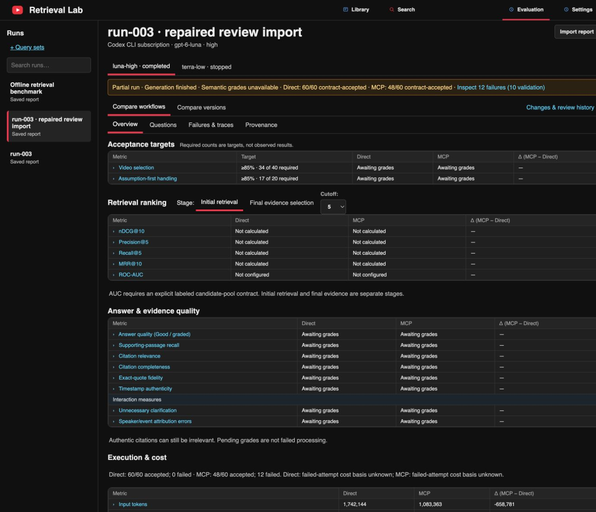
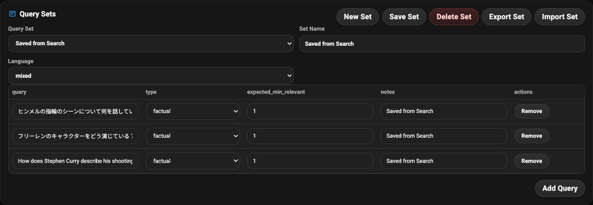
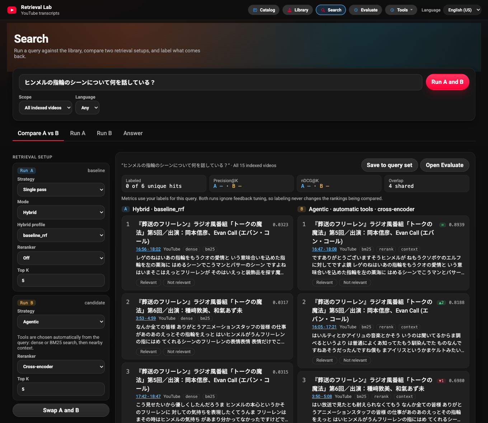
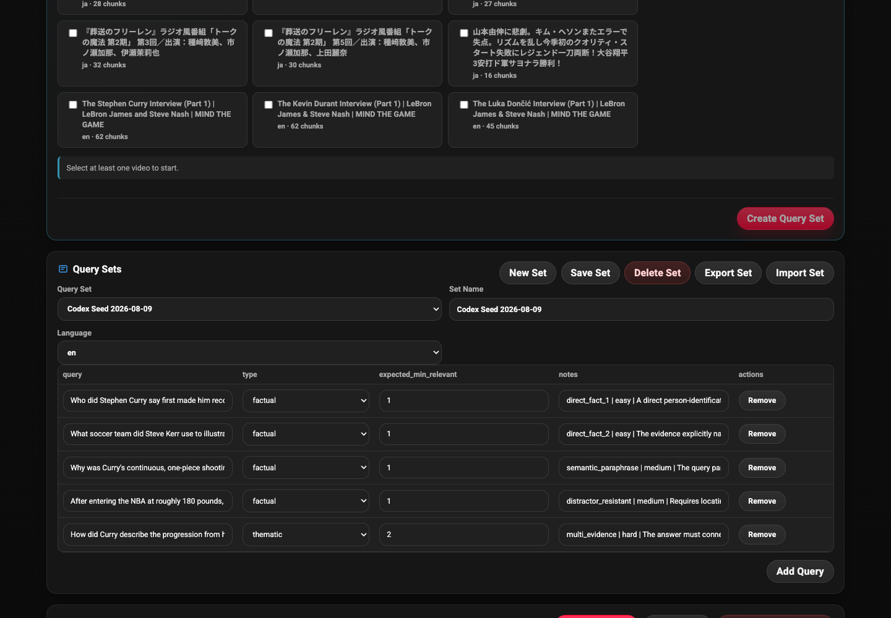

# Evaluation

The lab measures retrieval in three ways: an offline benchmark that needs no
network or keys, an interactive workspace for labeling real results, and tooling that
turns reviewed evidence into reusable datasets.



This is a saved historical report, not a new evaluation. Pending grades and
missing ranking measurements remain unavailable.

## Saved run review

**Evaluation** opens the local run-review dashboard at `/evaluation.html`.
Import an explicitly selected JSON report to review immutable local snapshots;
opening a report never launches a model or grading job. **Query sets** links to
the existing dataset workspace, with its browser storage and saved runs intact.

Supported imports include the public offline benchmark, the local subscription
review envelope, and API held-out reports. Real reports remain in ignored runtime
data and are not bundled with the app. The public app needs no private package.
Only supported review fields are retained; unknown measurements remain unknown.

The overview separates acceptance targets, initial/final retrieval ranking,
answer/citation quality, and execution/cost. Precision, Recall, MRR and nDCG are
shown only when recorded for that report and stage. ROC-AUC needs an explicit
candidate-pool contract. Synthetic fixture metrics never fill gaps in a real run.
Semantic passage recall and citation support require reviewed labels; exact text
and timestamp checks alone do not establish relevance.

CLI API-equivalent estimates are not subscription charges or provider invoices.
Reasoning tokens are already included in output. Failed-attempt inclusion follows the recorded cost basis, and absent usage is not zero. Version deltas require compatible
corpus, dataset, criteria, model/effort, stage and cutoff metadata; missing IDs
cannot certify comparability. Two acceptance targets are separate and use the
report's recorded denominators rather than assuming every dataset is Frozen60.

Metric drilldowns expose recorded question answers, canonical citations and safe
tool summaries. Where a report lacks metric-contribution links, the UI says so
before navigation rather than inventing affected questions. Question views group recorded workflow attempts by question and version comparisons scope them to the selected workflow.

## Offline benchmark

```bash
python -m evals.runner \
  --dataset evals/datasets/jp_core_v1.example.jsonl \
  --config evals/configs/baseline.yaml \
  --out evals/reports/latest
```

The runner needs no network access, provider keys, or model downloads. It
compares dense, lexical, baseline hybrid, optimized hybrid, and agentic retrieval,
and writes a leaderboard, per-query results, and failures to the gitignored
`evals/reports/`.

| Run                         | Precision@5 | Recall@5 | MRR@10 | nDCG@10 |
| --------------------------- | ----------: | -------: | -----: | ------: |
| `dense`                     |      0.2000 |   1.0000 | 0.4896 |  0.6193 |
| `lexical`                   |      0.2000 |   1.0000 | 0.9375 |  0.9539 |
| `hybrid_baseline` (default) |      0.2000 |   1.0000 | 0.7917 |  0.8452 |
| `optimized_hybrid`          |      0.2000 |   1.0000 | 1.0000 |  1.0000 |
| `agentic`                   |      0.2000 |   1.0000 | 0.9375 |  0.9539 |

These numbers come from an eight-query Japanese fixture with hand-authored dense
scores. They catch regressions in the harness and scoring; they do not show that
any strategy is better on real embedding indexes. The dataset schema, metric
definitions, and caveats are in [`evals/README.md`](../evals/README.md).

The [video-routing evaluator](../evals/video_routing/README.md) scores the
video-selection stage separately, using synthetic records whose labels stay
hidden from the router.

## Label in Search

Search compares Run A and Run B on one query. Mark each result **Relevant** or
**Not relevant**; the label is saved for that query and chunk, appears in both
columns, and updates the per-query Precision@K and nDCG@K for both runs. Both
runs skip feedback tuning, so labeling does not change the rankings being
compared. **Save to query set** adds the query to the **Saved from Search**
query set in Evaluate so it can be re-run later.





## Evaluate page

Open **Query sets** from Evaluation (`http://127.0.0.1:8000/evaluation-workbench.html`) to:

- create, import, and export query sets
- run retrieval and label results with reason codes
- score runs with Precision@K, Recall@K, MRR, and nDCG@K
- compare runs with aggregate and per-query deltas

Query sets, labels, and run snapshots are stored in browser `localStorage`.
Labels given in Search are stored separately in `data/runtime/`, feed the
server's default feedback tuning, and are listed under **Tools → Search
feedback**. Folding that page into Evaluate is planned.

## Draft a dataset with Codex CLI

Evaluate can turn one to three indexed transcripts into a six-case
retrieval draft. Install the Codex CLI and run `codex login` first.

- Each proposal stays a draft until you approve, edit, or reject it.
- The local API runs one ephemeral Codex pass in a read-only sandbox, validates
  every cited chunk against the selected videos, and does not forward provider
  API keys.
- Finalizing creates a browser query set and a JSONL dataset under the
  gitignored `data/runtime/eval_generator/`.
- `YT_RAG_CODEX_BIN` selects a CLI executable; `YT_RAG_CODEX_MODEL` overrides
  its model.



## Assisted labeling

`local_preview/review_agent_workflow.py` batches live `/v1/search` results,
renders reviewer prompts, builds adjudication inputs, and applies approved labels
through `/v1/feedback/search-review`. The commands are in the
[local app guide](../local_preview/README.md#assisted-labeling-workflow).

## Data quality (evidence curation)

`pipelines/curate_evidence.py` turns ingested transcript chunks into local
evidence artifacts with heuristic quality signals, topic tags, retrieval
eligibility, and a quality report. It calls no external services.

```bash
python pipelines/curate_evidence.py \
  --dataset-id demo_transcript_evidence \
  --dataset-version v1 \
  --language ja \
  --limit 200
```

Inspect the output under **Tools → Data quality** (`http://127.0.0.1:8000/evidence.html`).

## Limits

- Labels come from a single reviewer; inter-rater agreement and adjudication UI
  are not implemented.
- Answer quality (citation precision, faithfulness, abstention correctness) is
  not yet scored.
